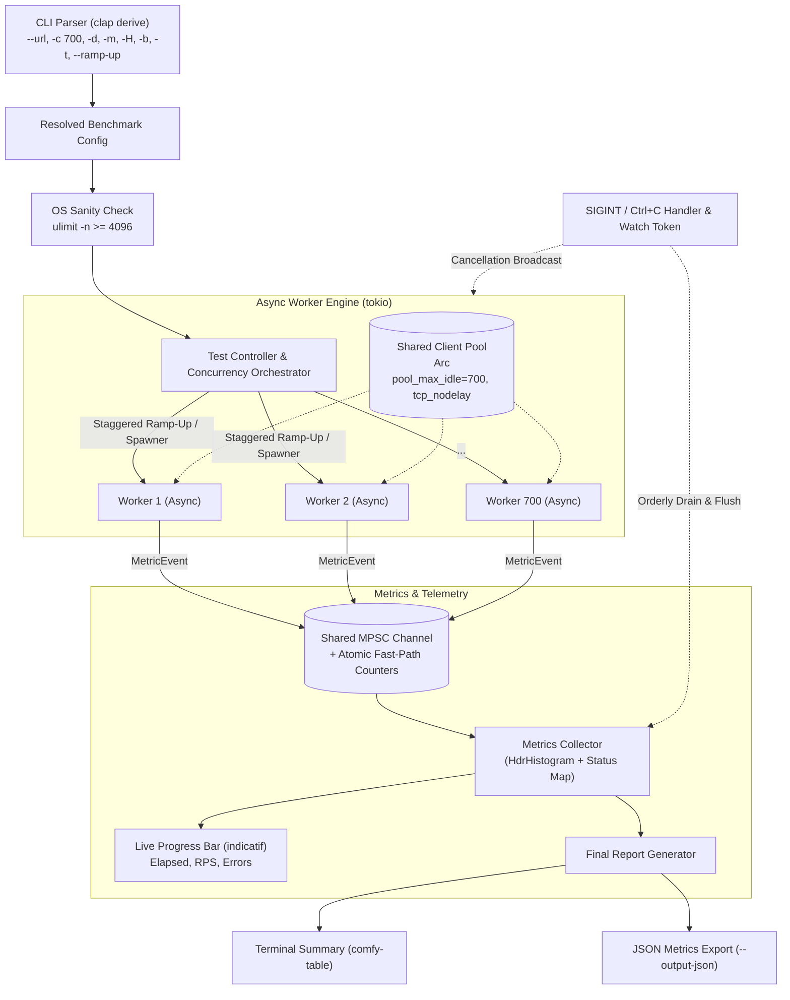
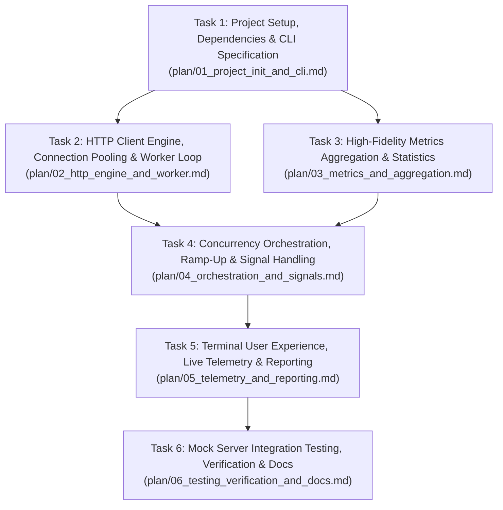

# Rusty-Loader: Sub-Agent Task Implementation Roadmap

This document outlines the master implementation plan for building **`rusty-loader`** (a high-performance, asynchronous Rust API load testing CLI capable of driving 700+ concurrent virtual users with sub-millisecond measurement fidelity).

The work is partitioned into **6 modular, sub-agent executable task specifications** located in this directory.

---

## 1. Architecture Overview

---

## 2. Sub-Agent Execution Flow & Dependency Graph

Tasks are designed to be executed sequentially or with partial parallelism where dependencies permit.

---

## 3. Sub-Agent Task Matrix

| Task ID | Specification File | Main Deliverables | Depends On | Verification Command |
|---|---|---|---|---|
| **Task 1** | [`01_project_init_and_cli.md`](./01_project_init_and_cli.md) | `Cargo.toml`, `src/cli.rs`, `src/config.rs`, argument validation | None | `cargo test --test cli_parsing_test` |
| **Task 2** | [`02_http_engine_and_worker.md`](./02_http_engine_and_worker.md) | `src/client.rs`, `src/os/mod.rs`, `src/engine/worker.rs` | Task 1 | `cargo test client::tests` |
| **Task 3** | [`03_metrics_and_aggregation.md`](./03_metrics_and_aggregation.md) | `src/metrics/event.rs`, `src/metrics/histogram.rs`, `src/metrics/stats.rs` | Task 1 | `cargo test metrics::tests` |
| **Task 4** | [`04_orchestration_and_signals.md`](./04_orchestration_and_signals.md) | `src/engine/mod.rs`, `src/engine/signals.rs`, ramp-up controller | Task 2, Task 3 | `cargo test engine::tests` |
| **Task 5** | [`05_telemetry_and_reporting.md`](./05_telemetry_and_reporting.md) | `src/reporter/live.rs`, `src/reporter/table.rs`, `src/reporter/json.rs` | Task 4 | `cargo run -- --help && cargo test reporter::tests` |
| **Task 6** | [`06_testing_verification_and_docs.md`](./06_testing_verification_and_docs.md) | Integration test suite, mock server harness, memory/RSS check, `README.md` | Task 5 | `cargo test --test integration_test` |

---

## 4. Engineering Standards & Design Constraints

1. **Zero Client-Side Latency Skew:**
   - Measurement starts immediately prior to dispatching the request: `let start = Instant::now()`.
   - Measurement completes only after reading the full response body bytes (`response.bytes().await`) to account for total wire transit time.
   - Non-blocking metrics dispatch: workers push to an MPSC channel or update atomic counters without contending on locks.

2. **Connection Pooling & FD Limits:**
   - Pre-tune `reqwest::Client` with `pool_max_idle_per_host(concurrency)` and `tcp_nodelay(true)`.
   - Keep alive: `tcp_keepalive(Some(Duration::from_secs(60)))`.
   - Warn user if OS file descriptor limit (`ulimit -n`) is $< 4096$.

3. **Memory Footprint:**
   - Maintain Resident Set Size (RSS) under 50 MB even under 700 concurrent async workers.
   - Response bodies are consumed in-memory as chunks/bytes and dropped immediately, not retained.

4. **Graceful Teardown:**
   - Intercept `SIGINT` (Ctrl+C) via `tokio::signal::ctrl_c()`.
   - Gracefully drain pending events in the MPSC channel and print the partial summary table before process exit.
