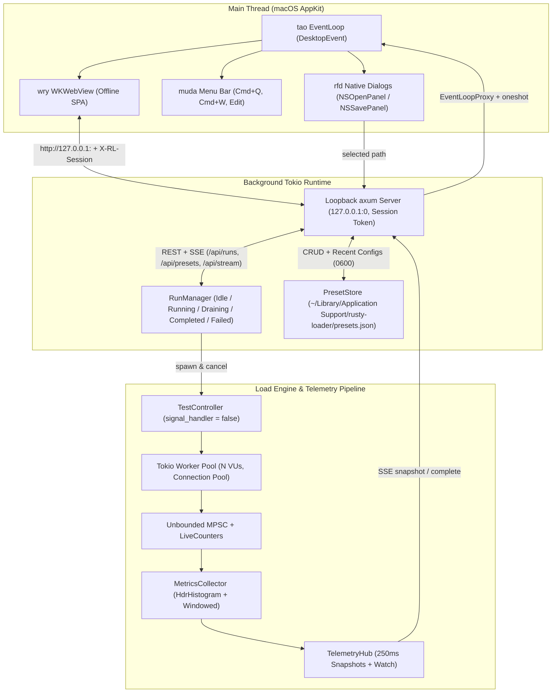

# Implementation Plan: macOS Desktop UI for Configuring, Running, and Visualizing Load Tests

- **Tracking Issue:** [seanr89/rusty-loader#9](https://github.com/seanr89/rusty-loader/issues/9)
- **Branch:** `feat/macos-desktop-ui`
- **Target Host Environment:** macOS (`rusty-loader.app` / Apple Silicon & Intel), while preserving full Linux/macOS CLI and `--no-default-features` headless parity

---

## 1. Context & Current Baseline

`rusty-loader` (`0.2.0`) currently provides a high-performance CLI load generator paired with an optional single-run embedded web dashboard and a macOS `.app` bundle wrapper:

1. **Core Load & Telemetry Engine (`src/cli.rs`, `src/config.rs`, `src/engine/`, `src/metrics/`):**
   - `TestController` (`src/engine/mod.rs`) orchestrates staggered worker spawning (`--ramp-up`), duration racing against `signals::wait_for_shutdown_signal`, 3-second graceful drain (`SHUTDOWN_GRACE_PERIOD`), and `MetricsCollector` / `TelemetryHub` (`src/metrics/mod.rs`, `src/metrics/snapshot.rs`) producing `250ms` windowed snapshots and cumulative 3-sig-fig `HdrHistogram` statistics (`BenchmarkStats`).
   - `Cli` (`src/cli.rs`) requires `--url` unless `--changelog` is passed, and `BenchmarkConfig::from_cli` (`src/config.rs`) handles URL validation, duration/timeout parsing, header parsing, and `@file` body loading.
2. **Embedded Monitoring Dashboard (`src/gui/`):**
   - `src/gui/api.rs` and `src/gui/server.rs` serve a self-contained zero-CDN HTML/CSS/Canvas 2D SPA (`src/gui/assets/{index.html,styles.css,app.js}`) with KPI cards, 3 live charts (Throughput & VUs, Windowed Latency Percentiles, Responses & Errors by Class), HTTP status/transport error tables, `POST /api/stop`, `GET /api/history`, `GET /api/stream` (SSE), `GET /api/export/json`, `GET /api/about`, and `GET /api/changelog`.
   - Currently, `AppState` and `start_gui_server` are bound to a single pre-started `BenchmarkConfig` + `TestController` launched from `src/main.rs` via `--url ... --gui`.
3. **macOS `.app` Bundle Packaging (`packaging/macos/`, `scripts/macos_bundle.sh`, `Makefile`):**
   - `make macos-bundle`, `make macos-install`, and `make macos-update` package `rusty-loader.app` with `Info.plist` populated from `Cargo.toml`.
   - Currently, `packaging/macos/launcher.sh.template` opens `Terminal.app` via `osascript` and prints `--version` and `--help` when launched from Finder or Spotlight without CLI arguments.

This plan bridges all three layers into a first-class **macOS desktop UI** where users can launch `rusty-loader.app` directly into a native window, enter or select saved/recent test configurations, launch and stop sequential benchmark runs, and watch live processed statistics, Canvas 2D charts, status/error breakdowns, and HDR summaries update in real time.

---

## 2. Architecture Decision: macOS Desktop Host

### Chosen Architecture
**Native macOS `WKWebView` window (`tao` + `wry`) + Native macOS Menu (`muda`) + Native File Dialogs (`rfd`)**, hosting the embedded loopback `axum` interactive server and upgraded offline SPA (`src/gui/assets/`).

### Rationale vs. Alternatives
| Option | Assessment | Decision |
| :--- | :--- | :--- |
| **Native `WKWebView` (`tao` + `wry` + `muda` + `rfd`) over loopback `axum`** | Reuses 100% of existing zero-CDN Canvas 2D charts, KPI cards, dark/light theme (`color-scheme`), About/Changelog modal, and `250ms` SSE pipeline. Compiles cleanly via pure Cargo (`cargo build --release`) with zero Node.js/npm/Tauri CLI dependency and integrates directly into the existing `Makefile` and `scripts/macos_bundle.sh`. | **Selected** |
| **Full Tauri v2 Stack** | Requires `tauri-cli`, separate `tauri.conf.json`/Node build pipeline, and heavier workspace restructure despite already having an embedded `axum` + SPA stack. | Rejected |
| **Pure Rust Immediate/Retained GUI (`egui` / `iced`)** | Duplicates all existing charting, responsive layout, table rendering, and theme/accessibility code already verified in `src/gui/assets/`. | Rejected |

### System Architecture



### macOS Main-Thread Threading Model
AppKit (`NSApplication`, `NSWindow`, `WKWebView`, `NSOpenPanel`, `NSSavePanel`) requires execution on the OS process main thread on macOS:

1. **Synchronous `fn main()` Dispatch (`src/main.rs`):**
   - Replace `#[tokio::main]` on `main()` with a synchronous `fn main() -> Result<()>`, parsing `Cli::parse()` first.
   - **CLI / `--changelog` / `--gui` / `--ui-serve` paths:** Construct a multi-threaded Tokio runtime (`tokio::runtime::Builder::new_multi_thread().enable_all().build()?`) and call `rt.block_on(...)`, preserving identical CLI lifecycle and signal handling.
   - **Desktop path (`--desktop` / `--ui`):**
     1. Apply macOS `RLIMIT_NOFILE` soft-limit raise (`os::raise_nofile_soft_limit(...)`) before spawning network workloads.
     2. Build the Tokio runtime and keep it alive on background worker threads.
     3. Bind the loopback interactive `axum` server (`127.0.0.1:0`) with a freshly generated session token and create `EventLoop::<DesktopEvent>::with_user_event()`.
     4. Hand the `EventLoopProxy<DesktopEvent>` into the interactive `AppState` so Axum handlers (`POST /api/dialog/open-body-file`, `POST /api/dialog/save-json`) trigger main-thread `rfd` dialogs and await the result over `tokio::sync::oneshot`.
     5. Create the `tao` window, `muda` macOS menus, and `wry` `WKWebView`, then enter `event_loop.run(...)` on the main thread.
2. **Graceful Teardown on Quit / Window Close:**
   - On `WindowEvent::CloseRequested` or `Cmd+Q` menu exit:
     - Invoke `RunManager::shutdown()` on the Tokio runtime to cancel any active `CancellationToken`, mark `TelemetryHub` draining, and wait up to `SHUTDOWN_GRACE_PERIOD` (`3s`) for in-flight workers to flush metrics.
     - Trigger graceful `axum` server shutdown, then exit the event loop cleanly (`ControlFlow::Exit`).

---

## 3. Security & Performance Guardrails

### 1. Loopback Binding & Per-Session Authentication (SSRF / CSRF Prevention)
- Interactive mode (`--desktop`, and default for `--ui-serve`) binds strictly to `127.0.0.1:0` (ephemeral loopback port).
- Generate a cryptographically random 256-bit hex session token at startup using `getrandom`.
- **Bootstrap & Enforcement:**
  - `wry::WebViewBuilder::with_initialization_script(...)` injects `window.__RL_SESSION_TOKEN__` (or navigates to `/?token=...` which sets an `HttpOnly; SameSite=Strict` cookie and redirects to `/` via `303`).
  - All mutating endpoints (`POST /api/runs`, `POST /api/runs/validate`, `POST /api/stop`, `POST/PUT/DELETE /api/presets*`, `POST /api/dialog/*`) enforce an Axum middleware checking the `X-RL-Session` header (or `HttpOnly` session cookie) via constant-time comparison; unauthorized calls return `401 Unauthorized`.
  - Browser-based `--ui-serve` prints the tokenized local URL (`http://127.0.0.1:<port>/?token=...`) so only the local user can authorize outbound load runs.

### 2. Credential & Sensitive Header Redaction
- Reuse `is_sensitive_header()`, `redact_headers()`, and `sanitize_url()` in `src/gui/api.rs`.
- In the UI configuration builder:
  - Header rows matching sensitive patterns (`Authorization`, `Cookie`, `X-Api-Key`, `*token*`, `*secret*`, `*password*`, `*credential*`, `*key*`) default to masked `<input type="password">` with an explicit per-row eye toggle.
  - `GET /api/meta`, `GET /api/runs`, `GET /api/runs/{id}`, and `GET /api/export/json` always return redacted headers (`"[REDACTED]"`) and sanitized URLs (`REDACTED:REDACTED@...`).
- `presets.json` in `~/Library/Application Support/rusty-loader/` is written atomically with `0600` Unix permissions (`OpenOptionsExt::mode(0o600)`), and exporting a preset as a shareable CLI command or JSON config provides a "Redact Secrets" toggle (enabled by default).

### 3. macOS `RLIMIT_NOFILE` Auto-Raise & Pre-Flight Warning
- LaunchServices on macOS commonly launches GUI `.app` bundles with a `256` soft file-descriptor limit (`RLIMIT_NOFILE`), which is insufficient for 700-VU benchmarks (`> 4096` recommended).
- Add `raise_nofile_soft_limit(preferred: u64)` in `src/os/unix.rs`:
  - Inspect `getrlimit(RLIMIT_NOFILE)` (`rlim_cur`, `rlim_max`).
  - On macOS, clamp target against `min(rlim_max, OPEN_MAX)` (trying fallback sequence `[preferred, 65536, 10240, 4096]`) using `libc::setrlimit(libc::RLIMIT_NOFILE, ...)`, never failing startup if raising is rejected.
- Expose live `OsLimits` (`soft_limit`, `hard_limit`, `recommended_min`, `sufficient`, `warning_message`) via `GET /api/system` so the UI displays a clear inline banner whenever `concurrency * 2 + 128 > soft_limit` (or `soft_limit < 4096`).

### 4. Zero-Regression CLI Performance & Feature Isolation
- Feature gates in `Cargo.toml`:
  - `gui = ["dep:axum", "dep:tokio-stream", "dep:futures-util", "dep:getrandom"]`
  - `desktop = ["gui", "dep:tao", "dep:wry", "dep:muda", "dep:rfd"]` (desktop crates scoped under `[target.'cfg(target_os = "macos")'.dependencies]` or guarded so Linux builds and `--no-default-features` headless CLI builds stay clean).
- Worker tasks (`src/engine/worker.rs`) only emit `MetricEvent` into the unbounded MPSC channel and increment atomic `LiveCounters`—never touching UI/WebView state—preserving `< 50 MB` RSS in CLI benchmarks (`scripts/verify_50_vu_load.sh`).

---

## 4. Phased Implementation Plan

### Phase 1 — Config Input Extraction, OS FD Raise & Multi-Run `RunManager`

#### Deliverables & Exact Changes
1. **`src/config.rs` — Shared Serde Input & Structured Field Validation**
   - Introduce `BenchmarkConfigInput` (`#[derive(Debug, Clone, Serialize, Deserialize)]`) mirroring all CLI/UI inputs:
     - `url: String`
     - `method: HttpMethod`
     - `concurrency: usize` (default `700`)
     - `duration: String` (default `"30s"`, parsed via `cli::parse_duration`)
     - `ramp_up: String` (default `"0s"`, parsed via `cli::parse_duration`)
     - `timeout: String` (default `"5000ms"`, parsed via `cli::parse_timeout`)
     - `headers: Vec<HeaderEntry>` (`{ name: String, value: String, enabled: bool }`)
     - `body_mode: BodyMode` (`None`, `Raw`, `File`)
     - `body: Option<String>`
     - `body_file: Option<PathBuf>`
     - `output_json: Option<PathBuf>`
   - Extract shared validation into `BenchmarkConfig::from_input(input: BenchmarkConfigInput) -> Result<BenchmarkConfig, ConfigError>` plus `validate_input(input: &BenchmarkConfigInput) -> ValidationReport` (returning structured `field -> message` errors for UI forms alongside CLI `ConfigError`).
   - Refactor `BenchmarkConfig::from_cli(cli: Cli)` to delegate through the same validation rules so CLI error behavior and `tests/cli_parsing_test.rs` stay 100% identical.

2. **`src/engine/mod.rs` — Optional Signal Handler Attachment**
   - Add `install_signal_handler: bool` (default `true`) and builder method `TestController::with_signal_handler(mut self, enabled: bool) -> Self`.
   - In `TestController::run_with_spawn_timestamps()`, gate `signals::wait_for_shutdown_signal(cancel_token.clone())` in `tokio::select!` on `self.install_signal_handler` so UI-driven runs do not install competing `ctrl_c()` handlers.

3. **`src/metrics/snapshot.rs` — Extended `TelemetryPhase`**
   - Add `Idle` and `Failed` variants to `TelemetryPhase` (`#[serde(rename_all = "snake_case")]` -> `"idle"`, `"ramping_up"`, `"running"`, `"draining"`, `"completed"`, `"failed"`).
   - Keep `TelemetryHub::current_phase()` returning `RampingUp | Running | Draining | Completed` for active/completed hubs so existing `--gui` tests stay unchanged.

4. **`src/os/mod.rs` & `src/os/unix.rs` — FD Limit Raise & Serialization**
   - Derive `Serialize` on `OsLimits`.
   - Add `pub fn raise_nofile_soft_limit(preferred: u64) -> OsLimits` in `src/os/unix.rs` and re-export in `src/os/mod.rs` (no-op returning `OsLimits::detect()` on non-Unix).

5. **New `src/gui/manager.rs` — Interactive Multi-Run `RunManager`**
   - Manage run lifecycle across sequential runs: `Idle -> RampingUp -> Running -> Draining -> Completed | Failed`.
   - Core state protected by `Arc<tokio::sync::RwLock<ManagerInner>>` / `std::sync::Mutex`:
     - `active_run: Option<ActiveRunState>` (`run_id`, `preset_name`, `config`, `sanitized_input`, `hub`, `counters`, `cancel_token`, `started_at`, `task_handle`)
     - `history: VecDeque<CompletedRunRecord>` (bounded to `MAX_RUN_HISTORY = 50`, storing `run_id`, `timestamp`, `preset_name`, `meta`, `stats`, `snapshots` summary, `error_message`)
     - `lifecycle_tx: broadcast::Sender<RunLifecycleEvent>` (`RunStarted`, `RunCompleted`, `RunFailed`, `StateChanged`)
   - Public methods:
     - `async fn start_run(&self, input: BenchmarkConfigInput, preset_name: Option<String>) -> Result<RunSummary, RunManagerError>` (enforces single-active-run guard returning `409 Conflict` if active; builds `BenchmarkConfig`, `TelemetryHub`, `TestController::from_config(config)?.with_signal_handler(false).with_telemetry_hub(...)`, spawns background task, publishes `RunStarted`).
     - `async fn stop_run(&self) -> Result<(), RunManagerError>` (calls `hub.mark_draining()` and `cancel_token.cancel()`).
     - `fn status_snapshot(&self) -> InteractiveStatusResponse`
     - `fn active_hub(&self) -> Option<Arc<TelemetryHub>>`
     - `fn list_runs(&self) -> Vec<CompletedRunRecordSummary>`
     - `fn get_run(&self, run_id: &str) -> Option<CompletedRunRecord>`
     - `async fn shutdown(&self)` (cancels active run and awaits task completion up to `SHUTDOWN_GRACE_PERIOD + 1s`).

---

### Phase 2 — Configuration Presets Store & Interactive REST/SSE API

#### Deliverables & Exact Changes
1. **New `src/presets.rs` — Local macOS Preset & Recent Config Persistence**
   - Resolve config directory cleanly:
     - Check `RUSTY_LOADER_CONFIG_DIR` env override first (used in deterministic tests).
     - On macOS: `$HOME/Library/Application Support/rusty-loader/presets.json`.
     - On other Unix/XDG hosts: `$XDG_CONFIG_HOME/rusty-loader/presets.json` or `$HOME/.config/rusty-loader/presets.json`.
   - Schema (`PresetsFile` v1):
     - `presets: Vec<SavedPreset>` (`id`, `name`, `description`, `config: BenchmarkConfigInput`, `created_at`, `updated_at`)
     - `recent: Vec<RecentRunConfig>` (capped at `MAX_RECENT_CONFIGS = 20`, deduplicated by normalized config fingerprint)
   - Implement `PresetStore` (`Arc<tokio::sync::RwLock<PresetsFile>>` + file path):
     - Seed non-destructive built-in starter examples only on first creation if desired, or keep clean list + "Insert Example" template helper.
     - Atomic writes: serialize to `<dir>/.presets.json.tmp.<pid>`, set `0600` permissions on Unix, `fs::rename` into place.
     - Provide `format_cli_command(input: &BenchmarkConfigInput, redact_secrets: bool) -> String` to generate copy-ready `rusty-loader` shell commands.

2. **`src/gui/api.rs` & `src/gui/server.rs` — Interactive Routes & Backwards-Compatible `--gui` Mode**
   - **Preserve CLI `--gui` behavior verbatim:** Keep `AppState`, `build_router`, `MetaResponse`, and `start_gui_server` working identically for `--url ... --gui` and all tests in `tests/gui_test.rs`.
   - Extend `MetaResponse` only with `#[serde(default)]` optional fields so existing consumers stay 100% compatible:
     - `mode: GuiMode` (`cli` | `interactive`)
     - `run_id: Option<String>`
     - `preset_name: Option<String>`
     - `error_message: Option<String>`
   - Add `InteractiveState` + `build_interactive_router(...)` + `start_interactive_gui_server(...)` in `src/gui/`:
     - **Session Auth Middleware:** Reject mutating endpoints with `401 Unauthorized` unless `X-RL-Session` header or `rl_session` cookie matches `session_token`.
     - **Bootstrap Route (`GET /`):** If `?token=<session_token>` matches, set `Set-Cookie: rl_session=<token>; HttpOnly; SameSite=Strict; Path=/` and serve/redirect to clean `/`.
     - **Interactive Endpoints:**
       - `GET /api/system` — OS limits (`OsLimits`), `recommended_min`, macOS desktop capabilities (`native_dialogs_available: bool`), app version.
       - `GET /api/meta` — Current phase (`idle` | `ramping_up` | `running` | `draining` | `completed` | `failed`), active or last-selected run metadata (redacted), `mode: "interactive"`.
       - `GET /api/history` — Returns `TelemetrySnapshot` history for the active run (or latest completed run, or `[]` when idle).
       - `GET /api/stream` — Persistent multi-run SSE connection: emits initial `state`, streams `run_started`, `snapshot` (`250ms`), `complete`, and `run_failed` across multiple sequential runs without closing when a single run finishes.
       - `POST /api/runs/validate` — Validates `BenchmarkConfigInput` + checks `OsLimits`, returning `{ valid, errors, warnings, cli_command }`.
       - `POST /api/runs` — Starts a run via `RunManager::start_run` (`202 Accepted` with `run_id`, `400 Bad Request` on invalid config, `409 Conflict` if a run is already active), and appends to `PresetStore::record_recent`.
       - `POST /api/stop` — Cancels the active run via `RunManager::stop_run`.
       - `GET /api/runs` — Lists session run history summaries.
       - `GET /api/runs/{id}` — Returns full `CompletedRunRecord` (final `BenchmarkStats`, metadata, snapshots) for inspection or comparison.
       - `GET /api/export/json` (with optional `?run_id=<id>`) — Exports redacted `JsonReport` for the active, latest, or selected historical run.
       - `GET /api/presets`, `POST /api/presets`, `PUT /api/presets/{id}`, `DELETE /api/presets/{id}` — Full CRUD on saved configurations.
       - `POST /api/dialog/open-body-file` — Opens native `rfd::FileDialog` on desktop main thread and returns `{ cancelled, path, size_bytes, preview_truncated }` (returns `501 Not Implemented` when running without desktop host, e.g. `--ui-serve`).
       - `POST /api/dialog/save-json` — Writes selected run `JsonReport` directly to user-chosen destination via native `rfd::FileDialog::save_file()` (or falls back cleanly in browser mode).

---

### Phase 3 — Interactive Frontend UI (`src/gui/assets/`)

Upgrade `index.html`, `styles.css`, and `app.js` while keeping all assets 100% embedded via `include_str!` and zero external CDN calls:

1. **Mode-Aware Layout (`cli` vs `interactive`)**
   - On startup, fetch `GET /api/meta` and `GET /api/system`.
   - When `meta.mode === "cli"`, hide the configuration sidebar and run history drawer so existing `--url ... --gui` renders identically.
   - When `meta.mode === "interactive"`, activate the desktop two-pane workspace:
     - **Collapsible Left Sidebar (Configuration & Presets):**
       - **Preset & Recent Selector:** Dropdown/searchable list of saved presets + recent runs, plus `New`, `Save`, `Save As`, `Duplicate`, and `Delete` actions, with unsaved-changes dirty indicator (`*`).
       - **Target & Request Form:** HTTP Method selector (`GET`, `POST`, `PUT`, `DELETE`, `PATCH`, `HEAD`), Target URL input, Concurrency (`VUs`), Duration (`30s`, `2m`, etc.), Ramp-up (`0s`, `10s`), Timeout (`5000ms`), and optional Output JSON path.
       - **Headers Editor:** Repeatable `Key` / `Value` rows with enable checkbox, delete button, and automatic masking (`type="password"` + reveal button) for sensitive header names (`Authorization`, `Cookie`, `X-Api-Key`, etc.).
       - **Payload Body Editor:** Segmented tabs (`None` / `Raw Text / JSON` with live byte count & format helper / `From File` with native macOS **Choose File…** button invoking `POST /api/dialog/open-body-file` and showing file path + byte size).
       - **Pre-Flight Feedback:** Inline per-field validation errors (via `POST /api/runs/validate`), macOS `RLIMIT_NOFILE` soft-limit warning banner when concurrency approaches FD limits, and **Copy CLI Command** button.
       - **Primary Run Controls:** **Start Load Test** (`Cmd+Enter`) / **Stop Run** (`Cmd+.`) button state synchronized with `RunManager` phase.
     - **Main Telemetry Workspace (Right Pane):**
       - Reuses and connects the existing 6 KPI cards, progress timer/bar, 3 Canvas 2D charts (`chart-throughput`, `chart-latency`, `chart-errors`) with hover tooltips and Pause Charts toggle, status code & transport error tables, final cumulative HDR summary strip (`min`, `mean`, `p50`, `p90`, `p95`, `p99`, `p99.9`, `max`, `std_dev`), and Export JSON button (using native Save dialog on macOS desktop).
       - **Session Run History & Comparison Drawer:** Click any previous run in the current session to inspect its charts/stats/tables, export its JSON report, load its config back into the editor, or select two runs for a side-by-side delta comparison (`req/s`, `p50`, `p95`, `p99`, error rate).

---

### Phase 4 — Native macOS Desktop Host, CLI Flags & `.app` Bundle Packaging

1. **`Cargo.toml` Dependencies & Features**
   - Update features:
     ```toml
     [features]
     default = ["gui", "desktop"]
     gui = ["dep:axum", "dep:tokio-stream", "dep:futures-util", "dep:getrandom"]
     desktop = ["gui", "dep:tao", "dep:wry", "dep:muda", "dep:rfd"]
     ```
   - Add `getrandom = "0.2"` (or `"0.3"`) as optional dependency under `gui`.
   - Add macOS target-scoped desktop crates under `[target.'cfg(target_os = "macos")'.dependencies]`:
     - `tao` (optional) — native macOS window & `EventLoop`
     - `wry` (optional) — `WKWebView` embedding
     - `muda` (optional) — native macOS App/Edit/Window menu bar (`Cmd+Q`, `Cmd+W`, `Cmd+C/V/X/A`, `Cmd+R`)
     - `rfd` (optional) — native macOS `NSOpenPanel` / `NSSavePanel` dialogs
   - Gate `src/desktop/mod.rs` with `#[cfg(all(feature = "desktop", target_os = "macos"))]`, falling back cleanly on non-macOS platforms with an explicit error message if `--desktop` is passed on Linux/Windows (while `--ui-serve` still works cross-platform in the user's browser).

2. **`src/cli.rs` & `src/main.rs`**
   - Add CLI flags to `Cli`:
     - `#[arg(long = "desktop", visible_alias = "ui", default_value_t = false)] pub desktop: bool` — launches the native macOS desktop UI without requiring `--url`.
     - `#[arg(long = "ui-serve", default_value_t = false)] pub ui_serve: bool` — starts the interactive configuration & telemetry web server on loopback and opens the default browser (works on macOS and headless/SSH Linux).
   - Update `--url` clap attribute from `required_unless_present = "changelog"` to `required_unless_present_any = ["changelog", "desktop", "ui_serve"]` (keeping `default_value = ""` and adding conflict checks if both `--url` and `--desktop`/`--ui-serve` are passed ambiguously, or pre-filling the UI form when `--url` is provided with `--desktop`).
   - Refactor `src/main.rs` to synchronous `fn main() -> Result<()>` with clear mode dispatch:
     1. `--changelog` -> print changelog & exit
     2. `--desktop` -> `run_desktop_app(...)` (macOS native window on main thread + background Tokio runtime)
     3. `--ui-serve` -> Tokio runtime serving `start_interactive_gui_server(...)` + `open_browser_url(...)` until `Ctrl+C`
     4. Standard CLI (`--url`, optional `--gui`) -> existing Tokio CLI execution path verbatim

3. **New `src/desktop/mod.rs` — macOS Window, Menu, WebView & Dialog Bridge**
   - Define `enum DesktopEvent`:
     - `OpenBodyFile(oneshot::Sender<Option<PathBuf>>)`
     - `SaveJsonReport { default_name: String, resp: oneshot::Sender<Option<PathBuf>> }`
     - `QuitRequested`
   - Build macOS native `muda::Menu` (App menu with **About rusty-loader**, Hide, Quit `Cmd+Q`; Edit menu with Undo/Redo/Cut/Copy/Paste/Select All so clipboard shortcuts work inside `WKWebView` inputs; Window menu with Minimize/Zoom/Close `Cmd+W`).
   - Initialize `tao::window::WindowBuilder` (`title: "rusty-loader"`, default `1360x880`, minimum `1024x680`, centered/resizable) and `wry::WebViewBuilder::new()` navigating to `http://127.0.0.1:<port>/?token=<session_token>` (with DevTools enabled in debug builds).
   - Handle `DesktopEvent` on main thread to execute `rfd::FileDialog::new().pick_file()` and `rfd::FileDialog::new().set_file_name(...).save_file()`.
   - On quit/close, run `manager.shutdown()` + `server_handle.shutdown()` inside `rt.block_on(...)` before exiting.

4. **macOS Bundle Packaging Updates (`packaging/macos/`, `scripts/macos_bundle.sh`, `Makefile`)**
   - **`packaging/macos/launcher.sh.template`:**
     - When invoked with CLI flags (args present and `$1` does not start with `-psn_`), continue transparent CLI pass-through: `exec "$BIN" "$@"`.
     - When launched from Finder, Spotlight, Dock, or `open rusty-loader.app` (no args or `-psn_*`), replace the `osascript` `Terminal.app` snippet with:
       ```bash
       exec "$BIN" --desktop
       ```
   - **`packaging/macos/Info.plist.template`:**
     - Add `NSAppTransportSecurity` with `<key>NSAllowsLocalNetworking</key><true/>` so `WKWebView` allows `http://127.0.0.1:<port>` traffic cleanly under macOS App Transport Security.
     - Add optional `<key>CFBundleIconFile</key>` when an `.icns` asset is bundled, plus `LSApplicationCategoryType` (`public.app-category.developer-tools`).
   - **`scripts/macos_bundle.sh` & `Makefile`:**
     - Update `cmd_bundle()` to copy `packaging/macos/rusty-loader.icns` into `Contents/Resources/` if present (and keep `make macos-bundle`, `make macos-install`, `make macos-update`, `make macos-uninstall` working seamlessly with ad-hoc or Developer ID codesigning).
     - Verify `stop_running_app()` in `scripts/macos_bundle.sh` still cleanly terminates running `rusty-loader.app` desktop instances on `make macos-update`.

---

### Phase 5 — Testing, Performance Verification & Documentation

1. **New Automated Tests**
   - **`tests/run_manager_test.rs`:**
     - Validate `BenchmarkConfigInput` field errors (`400` with field map) and valid conversion.
     - Test multi-run lifecycle (`Idle -> Running -> Completed -> Running -> Completed`) via `RunManager` against `wiremock`.
     - Verify single-active-run guard (`409 Conflict` when starting while another run is active).
     - Verify mid-run cancellation (`POST /api/stop` drains and populates partial stats in session history).
     - Verify persistent SSE stream emits `state`, `run_started`, `snapshot`, and `complete` across two consecutive runs without closing.
     - Verify session-token enforcement (`401 Unauthorized` without `X-RL-Session` / cookie; `200`/`202` with valid token).
   - **`tests/presets_test.rs`:**
     - CRUD lifecycle (`POST`, `GET`, `PUT`, `DELETE`) backed by temporary `RUSTY_LOADER_CONFIG_DIR`.
     - Atomic file write persistence across `PresetStore` reloads and `0600` file permissions check on Unix.
     - Recent runs deduplication & `20`-item cap.
     - Secret header redaction on JSON export & CLI command formatting.
   - **Regression & Feature-Matrix Verification:**
     - `cargo test` (existing `cli_parsing_test`, `gui_test`, `integration_test`, `metrics_test`, `orchestrator_test`, `reporter_test`, `changelog_test`, `client_worker_test`, plus new tests).
     - `cargo check --no-default-features` and `cargo test --no-default-features` (verifies headless CLI build compiles and passes with zero GUI/desktop crates).
     - `cargo test --no-default-features --features gui` (verifies `--gui` / `--ui-serve` build without desktop host crates).
     - `bash scripts/verify_50_vu_load.sh` (verifies 50-VU `--gui` `< 50 MB` RSS guardrail remains intact).
   - **macOS Bundle & Launch Verification:**
     - `make macos-bundle` -> `plutil -lint target/release/bundle/rusty-loader.app/Contents/Info.plist` -> `codesign --verify --deep --strict target/release/bundle/rusty-loader.app`.
     - Verify CLI invocation via `target/release/bundle/rusty-loader.app/Contents/MacOS/rusty-loader-launcher --version` and GUI launch via `open target/release/bundle/rusty-loader.app`.
     - Verify `make macos-install APP_DIR=~/Applications` and `make macos-update APP_DIR=~/Applications`.

2. **Documentation Updates**
   - Update `README.md` with:
     - macOS Desktop Application section (`rusty-loader.app`, configuration builder, presets location `~/Library/Application Support/rusty-loader/presets.json`, live telemetry, run history comparison, JSON save).
     - `--desktop` (`--ui`) and `--ui-serve` CLI reference rows.
     - Updated feature flags (`gui`, `desktop`, `--no-default-features`).

---

## 5. File & Module Change Matrix

| File | Phase | Status | Responsibility |
| :--- | :--- | :--- | :--- |
| `src/config.rs` | 1 | Modified | Add `BenchmarkConfigInput`, `HeaderEntry`, `BodyMode`, `ValidationReport`, `from_input()` |
| `src/engine/mod.rs` | 1 | Modified | Add `with_signal_handler(bool)` on `TestController` |
| `src/metrics/snapshot.rs` | 1 | Modified | Add `TelemetryPhase::Idle` and `TelemetryPhase::Failed` |
| `src/os/mod.rs`, `src/os/unix.rs` | 1 | Modified | Serialize `OsLimits`; add `raise_nofile_soft_limit()` |
| `src/gui/manager.rs` | 1 | New | `RunManager`, `CompletedRunRecord`, `RunLifecycleEvent`, bounded run history |
| `src/presets.rs` | 2 | New | `PresetStore`, atomic `presets.json` persistence (`0600`), recent runs, CLI formatter |
| `src/lib.rs`, `src/gui/mod.rs` | 1–4 | Modified | Export `presets`, `gui::manager`, and conditional `desktop` modules |
| `src/gui/api.rs`, `src/gui/server.rs` | 2 | Modified | Session-token auth, interactive `/api/*` routes, multi-run SSE, preserve CLI `--gui` API |
| `src/gui/assets/{index.html,styles.css,app.js}` | 3 | Modified | Interactive configuration sidebar, presets UI, live charts/KPIs, history comparison |
| `Cargo.toml` | 4 | Modified | Add `desktop` feature + macOS-scoped `tao`/`wry`/`muda`/`rfd` + `getrandom` |
| `src/desktop/mod.rs` | 4 | New | macOS main-thread `tao` window, `wry` WKWebView, `muda` menu, `rfd` dialog bridge |
| `src/cli.rs`, `src/main.rs` | 4 | Modified | Add `--desktop` / `--ui-serve`; sync `main()` dispatch between CLI and macOS desktop |
| `packaging/macos/launcher.sh.template` | 4 | Modified | Launch `$BIN --desktop` from Finder/Spotlight while forwarding CLI flags |
| `packaging/macos/Info.plist.template` | 4 | Modified | Add `NSAppTransportSecurity` (`NSAllowsLocalNetworking`) and app category/icon keys |
| `scripts/macos_bundle.sh`, `Makefile` | 4 | Modified | Bundle icon resource if present; keep bundle/install/update targets clean |
| `tests/run_manager_test.rs`, `tests/presets_test.rs` | 5 | New | Multi-run lifecycle, auth token, validation, preset persistence, and redaction tests |
| `README.md` | 5 | Modified | Document macOS desktop UI, presets path, `--desktop`/`--ui-serve`, and build features |

---

## 6. Verification Commands Matrix

| Phase | Verification Command |
| :--- | :--- |
| **Phase 1** | `cargo test config` && `cargo test os::tests` && `cargo test engine::tests` |
| **Phase 2** | `cargo test --test presets_test` && `cargo test --test gui_test` |
| **Phase 3** | `cargo test --test run_manager_test` + interactive manual UI check via `cargo run -- --ui-serve` |
| **Phase 4** | `cargo check --no-default-features` && `cargo test --no-default-features` && `make macos-bundle` && `codesign --verify --deep --strict target/release/bundle/rusty-loader.app` |
| **Phase 5** | `cargo test` && `bash scripts/verify_50_vu_load.sh` && `make macos-install APP_DIR=~/Applications` |

---

## 7. Key Pitfalls & Engineering Risks

1. **AppKit Main-Thread Violation (`SIGABRT`):** `tao`/`wry`/`muda`/`rfd` must run on thread 0 (process main thread) on macOS. Never initialize `EventLoop` inside `#[tokio::main]` worker threads or call `rfd::FileDialog` directly from async Axum handlers; always dispatch via `EventLoopProxy<DesktopEvent>` + `oneshot`.
2. **`WKWebView` Blocking `http://127.0.0.1`:** macOS App Transport Security (ATS) can block non-HTTPS requests inside bundled `.app` WebViews unless `NSAppTransportSecurity -> NSAllowsLocalNetworking = true` is explicitly configured in `Info.plist`.
3. **LaunchServices `256` File Descriptor Soft Limit:** Apps opened from Finder/Spotlight inherit `ulimit -n = 256`, which causes `EMFILE` socket failures under 700 VUs unless raised early via `setrlimit(RLIMIT_NOFILE, ...)` and surfaced in the UI when capped.
4. **Tokio `ctrl_c()` Contention:** Having `TestController` register its own `ctrl_c()` listener inside background GUI-driven runs can interfere with desktop shutdown hooks; isolate via `TestController::with_signal_handler(false)`.
5. **Backwards Compatibility of `--gui` & Existing Tests:** `tests/gui_test.rs` and `tests/cli_parsing_test.rs` assert exact `Cli`, `GuiConfig`, `MetaResponse`, and `/api/stream` behavior for CLI `--gui` runs. Keep `start_gui_server` intact and only extend `MetaResponse` with `#[serde(default)]` fields.
6. **Code Signing & Gatekeeper:** Verify `make macos-bundle`, `make macos-install`, and `make macos-update` produce valid strict signatures (`codesign --verify --deep --strict`) with both ad-hoc (`-`) and Developer ID certificates after adding `WKWebView` / `Info.plist` entitlements/keys.
