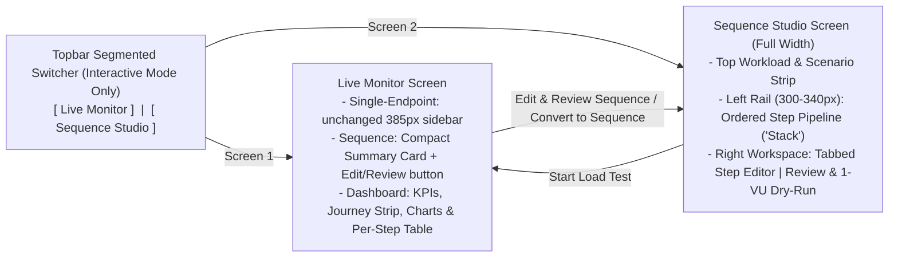

# Technical Specification & Implementation Plan: Ordered Multi-Step API Sequences (User Journeys)

- **Tracking Issue:** [seanr89/rusty-loader#15](https://github.com/seanr89/rusty-loader/issues/15)
- **Branch:** `feat/ordered-api-sequences` (branched from `main` at `2bbcd6e`)
- **Scope:** Ordered multi-step scenario data model & static validation, dedicated **Sequence Studio** UI screen (`--desktop` / `--ui-serve`), pre-run flow review & 1-VU dry-run trace, sequential VU worker execution with response-to-request variable passing, multi-host connection pooling, per-step & journey HDR telemetry, CLI (`--scenario`, `--review`, `--dry-run`), and `JSON`/`CSV`/`PDF` exports.

---

## 1. Context & Current Baseline

`rusty-loader` (`0.2.0`) currently executes single-request load tests across CLI, embedded `--gui`, `--ui-serve`, and native macOS `--desktop` modes:

1. **Single-Endpoint Configuration (`src/config.rs`, `src/cli.rs`, `src/presets.rs`):**
   - `BenchmarkConfig` and `BenchmarkConfigInput` model one `url`, `method`, `headers`, `body_mode` (`None | Raw | File`), `body`, and `body_file`.
   - `PresetStore` (`presets.json`, `0600` permissions on Unix) persists `SavedPreset` and `RecentRunConfig` entries wrapping `BenchmarkConfigInput`.
2. **HTTP Client & Worker Loop (`src/client.rs`, `src/engine/worker.rs`, `src/engine/mod.rs`):**
   - `build_client()` attaches `config.headers` globally via `ClientBuilder::default_headers(...)` and caps background connects via `PoolCapConnectorLayer::new(config.concurrency)`.
   - `Worker::run()` loops `execute_once()` on one static `Request`, streaming and immediately dropping response chunks (`drop(chunk)`) to maintain `< 50 MB` CLI RSS.
   - `TestController` manages ramp-up spawning (`spawner::spawn_workers_with_counters`), `SIGINT` / cancellation racing, and a 3-second graceful drain (`SHUTDOWN_GRACE_PERIOD`).
3. **Telemetry & Exports (`src/metrics/`, `src/reporter/`):**
   - `MetricEvent`, `LiveCounters`, `MetricsCollector`, `TelemetryHub`, `TelemetrySnapshot`, and `BenchmarkStats` aggregate request-level latency, status codes, transfer bytes, and transport errors without step attribution or journey completion tracking.
   - `ExportReport` (`src/reporter/export.rs`), `JsonReport` (`src/reporter/json.rs`), RFC 4180 CSV (`CSV_HEADERS` in `src/reporter/csv.rs`), and vector PDF (`src/reporter/pdf.rs`) share redacted config metadata, cumulative stats, and `250ms` windowed snapshots.
4. **Desktop & Web UI (`src/desktop/mod.rs`, `src/gui/interactive.rs`, `src/gui/assets/`):**
   - Native `tao` + `wry` (`WKWebView`) window (`1360x880` default, `1024x680` minimum) or `--ui-serve` loopback `axum` server hosts a zero-CDN SPA: `.topbar` above `.workspace-layout` containing a fixed `385px` `.config-sidebar` and `.dashboard-main`, authenticated via `X-RL-Session` / `rl_session` cookie and subscribed to persistent `/api/stream` SSE events.

This specification extends `rusty-loader` to support **stacked and ordered API call sequences** where each Virtual User (VU) runs steps `1..N` in strict sequence, extracts dynamic values from responses into per-VU iteration state, validates dependencies prior to load, verifies workflows with a 1-VU dry-run trace, and reports per-step + end-to-end journey telemetry.

---

## 2. UI/UX Architecture Decision: Dedicated Screen vs. Existing Workbench

### Design Question
> Should multi-step endpoint configuration live inside the existing configuration sidebar or on a dedicated screen?

### Architectural Evaluation

| Option | Assessment | Decision |
| :--- | :--- | :--- |
| **A. Expand existing `385px` left sidebar (`.config-sidebar`)** | Severely cramped for editing 3–10 ordered steps, per-step URLs/headers/bodies, JSONPath/header extractors, assertions, failure policies, and variable dependency flow. Forces nested scroll traps and hides the end-to-end stacked call graph. | **Rejected** |
| **B. Disconnected separate HTML route or second native macOS window** | Provides full viewport width, but breaks SPA continuity in `WKWebView` (route navigation drops live `/api/stream` SSE state and chart buffers) and adds window-management friction when toggling between tuning Step #2 and watching live `p99` telemetry. | **Rejected** |
| **C. Dedicated Full-Width In-SPA Screen (`Sequence Studio`) via Top-Bar View Switcher** | **Validates the instinct for a dedicated screen** while remaining inside `.app-shell`. Adds a 2-way segmented switcher in `.topbar` (`Live Monitor` ↔ `Sequence Studio`, interactive mode only; hidden in CLI `--gui`). Gives the full `1024–1440px` desktop canvas to endpoint sequencing, dataflow review, and 1-VU dry-run traces without interrupting `RunManager` or the persistent SSE stream. | **Selected** |

### How the Two Screens Cooperate



#### Screen 1 — `Live Monitor` (Existing Workbench, Enhanced)
- **Single-Endpoint Mode (`RequestMode::Single`):** 100% unchanged (`385px` sidebar + live KPIs/charts/tables), plus a subtle **"Convert to Sequence…"** button that promotes the current request into Step #1 inside `Sequence Studio`.
- **Sequence Mode (`RequestMode::Sequence`):**
  - The `385px` sidebar swaps the single-request form for a clean **Compact Sequence Summary Card**: preset selector, shared workload controls (`Concurrency`, `Duration`, `Ramp-Up`, `Default Timeout`), compact ordered step pill chain (`1. Login → 2. Create Cart → 3. Checkout`), validation status badge, **`Edit & Review Sequence →`** (switches to `Sequence Studio`), **`Dry-Run (1 VU)`**, and **`Start Load Test`**.
  - `.dashboard-main` adds a **Journey Summary Strip** (Completed Journeys/s, Completion Rate %, Aborted Iterations, End-to-End p95) and a **Per-Step Breakdown Table** (`#`, `Step`, `Method`, `Target`, `Requests`, `RPS`, `p50`, `p95`, `p99`, `Errors`, `Aborts`), plus an optional step filter for status/error inspection.

#### Screen 2 — `Sequence Studio` (New Full-Width Endpoint Configuration & Review Screen)
Designed cleanly for the minimum window (`1024x680`) up to full-width (`1440px`):

```text
+---------------------------------------------------------------------------------------------------+
| Topbar: [rusty-loader]   [ Live Monitor | *Sequence Studio* ]   [ Export v ] [ About ] [ Theme ] |
+---------------------------------------------------------------------------------------------------+
| Sequence Control Strip:                                                                           |
| Preset: [Checkout User Flow v] [New] [Save] [Save As] [Import] [Export]                           |
| Base URL: [https://api.example.com]  VUs: [50]   Dur: [30s]  Ramp: [10s]  Timeout: [5000ms]       |
| [Shared Defaults: Headers (2) / Init Vars (1) / Auto-Export]  [Validate] [Dry-Run 1 VU] [*Start*] |
+------------------------------------+--------------------------------------------------------------+
| Left Rail (320px): Step Pipeline   | Right Workspace (Flexible):                                  |
|                                    | Tabs: [ Edit Step #2: Create Cart ]  [ Review & Dry-Run ]    |
| +--------------------------------+ |--------------------------------------------------------------|
| | #1 [POST] Login           [on] | | Step Name: [Create Cart        ]  Method: [POST v]  [Enabled]|
| |    /v1/auth/login              | | Path / URL: [/v1/carts/{{user_id}}                         ] |
| |    out: token, user_id | abort | | Insert var: [+ {{token}}] [+ {{user_id}}] [+ {{__vu_id}}]    |
| +--------------------------------+ |--------------------------------------------------------------|
|              |  (think: 0ms)       | Sub-tabs: [ Request ]  [ Extract Variables ]  [ Flow/Checks ]|
|              v                     |                                                              |
| +--------------------------------+ | - Headers (step overrides + collapsible inherited base hdrs) |
| | #2 [POST] Create Cart *   [on] | | - Body Mode: ( ) None  (*) Raw / JSON  ( ) From File         |
| |    /v1/carts/{{user_id}}       | |   { "currency": "USD", "owner": "{{user_id}}" }            |
| |    in: token, user_id          | |                                                              |
| |    out: cart_id       | abort  | |                                                              |
| +--------------------------------+ |                                                              |
|              |  (think: 250ms)     |                                                              |
|              v                     |                                                              |
| +--------------------------------+ |                                                              |
| | #3 [POST] Checkout        [on] | |                                                              |
| |    /v1/orders                  | |                                                              |
| |    in: token, cart_id | abort  | |                                                              |
| +--------------------------------+ |                                                              |
| [ + Add Step ]                     |                                                              |
+------------------------------------+--------------------------------------------------------------+
```

1. **Top Sequence Control Strip:**
   - Preset/scenario CRUD (`New`, `Save`, `Save As`, `Delete`) plus `Import JSON` / `Export JSON` (invoking native `NSOpenPanel` / `NSSavePanel` on macOS desktop).
   - Optional `Base URL` (allowing steps to use relative paths like `/v1/orders`) and shared workload controls (`Concurrency`, `Duration`, `Ramp-Up`, `Default Timeout`).
   - Collapsible **Shared Defaults** drawer for scenario-level `default_headers` (inherited by all steps unless overridden per step), `initial_variables` (e.g., `api_env`, seeded test account), and auto-export paths (`--output-json`, `--output-csv`, `--output-pdf`).
   - Primary workflow actions: **`Validate`**, **`Dry-Run (1 VU)`**, and **`Start Load Test`** (starting a load run transitions immediately to `Live Monitor` so the user sees live charts at tick 1).
2. **Left Rail (`300–340px`, scrollable): Ordered Step Pipeline ("Stack"):**
   - Numbered vertical step cards connected by order arrows (`↓`) and optional inter-step think-time pills (`⏱ 250ms`).
   - Each card displays: step order (`#1`, `#2`, ...), accessible **Move Up / Move Down** buttons + drag handle, enable/disable toggle, HTTP method pill, step name, target URL/path, failure policy badge (`abort` / `continue`), and live **dataflow badges** (`in: token`, `out: cart_id`, plus an inline red warning pill if a variable reference is unresolved or produced later in the chain).
   - Per-step **Duplicate** and **Delete** controls, plus **`+ Add Step`** at the bottom of the stack.
3. **Right Primary Workspace (Flexible `680–1050px`): Tabbed Step Inspector & Review Panel:**
   - Top workspace tabs switch cleanly between **`Edit Step #N`** and **`Review & Dry-Run (1 VU)`** (with an optional side-by-side split review toggle on viewports `>= 1320px`).
   - **`Edit Step #N` — 3 Focused Sub-Tabs** (avoids giant single-form scrolling):
     1. **`Request` Tab:**
        - Step Name, Enabled toggle, HTTP Method (`GET`, `POST`, `PUT`, `DELETE`, `PATCH`, `HEAD`), URL or relative path input, and a clickable **`Insert {{var}}`** chip bar populated dynamically with variables produced by preceding enabled steps plus built-in VU vars (`{{__vu_id}}`, `{{__iteration}}`, `{{__timestamp_ms}}`).
        - Step-specific Headers editor (with existing sensitive-header password masking and eye toggle) plus a collapsible read-only list of inherited scenario `default_headers` showing which keys are overridden at this step.
        - Step Body selector (`None` | `Raw / JSON` with live byte count, Format JSON button, and `{{var}}` insertion | `From File` with native macOS `Choose File…`).
     2. **`Extract Variables` Tab:**
        - Repeatable extractor rows binding response data to per-VU iteration variables:
          - `Variable Name` (validated identifier `[A-Za-z_][A-Za-z0-9_]*`)
          - `Source`: `JSON Body` (dot/bracket path e.g. `$.data.access_token`, `$.items[0].id`), `Response Header` (case-insensitive header name e.g. `location`), `Cookie` (parsed from `Set-Cookie` headers by cookie name), or `Status Code`
          - `Required` toggle (default `true` — missing value fails the step)
          - `Sensitive (Redact)` toggle (auto-enabled via `is_sensitive_var_name` for `token`, `secret`, `key`, `auth`, `cookie`, `password`, `session`, `jwt`, `bearer`, `credential`)
     3. **`Expectations & Flow` Tab:**
        - Status expectation: `Any 2xx` (default), `Exact Codes` (e.g. `200, 201`), `Status Range` (e.g. `200..299`), or `Any`.
        - Optional JSON body assertions (`path` `exists` or `equals` literal JSON value).
        - `On Step Failure` policy: `Abort Iteration` (default — stop sequence and start next VU iteration) or `Continue` (record failure and proceed to next step).
        - `Think Time After Step` (e.g. `0ms`, `250ms`) and optional `Step Timeout Override`.
   - **`Review & Dry-Run (1 VU)` Tab:**
     - **Static Execution Review Matrix:** Ordered table (`# | Step | Method & Target | Consumes | Produces | Assertions | On Failure`), dependency/scope diagnostics (undefined variables, out-of-order references, disabled producers, unused extractions, shadowed names, multi-host FD impact), and copyable CLI command (`rusty-loader --scenario ...`).
     - **1-VU Dry-Run Trace Inspector:** Runs one full iteration via `POST /api/scenarios/dry-run` and displays expandable per-step trace cards showing resolved sanitized URL, HTTP status + pass/fail badge, latency (`ms`), bytes received, extracted variables (secrets masked as `[REDACTED (len=N)]`), assertion pass/fail reasons, and a bounded (`<= 4 KB`) secret-scrubbed response body preview.
4. **Active Run Locking:** While `RunManager` is in `RampingUp`, `Running`, or `Draining`, `Sequence Studio` remains accessible in read-only inspection mode (editing controls disabled with an active-run notice banner) so users can inspect the running flow without mutating state mid-test.

---

## 3. Data Contracts, Scenario Schema & Template Engine

### 1. Backwards-Compatible `BenchmarkConfigInput` (`src/config.rs`)
Extend `BenchmarkConfigInput` using `#[serde(default)]` so every existing single-URL preset and API caller continues working unchanged:

```rust
#[derive(Debug, Clone, Copy, Default, PartialEq, Eq, Serialize, Deserialize)]
#[serde(rename_all = "snake_case")]
pub enum RequestMode {
    #[default]
    Single,
    Sequence,
}
```

- Add to `BenchmarkConfigInput`:
  - `#[serde(default)] pub mode: RequestMode`
  - `#[serde(default, skip_serializing_if = "Option::is_none")] pub scenario: Option<ScenarioConfigInput>`
- Add to `BenchmarkConfig`:
  - `pub execution_plan: ExecutionPlan` (`Single` | `Sequence(Arc<CompiledScenario>)`), while keeping existing single-endpoint fields intact when `Single` so existing unit/integration tests and `JsonReport::new` remain untouched.

### 2. Scenario Schema (`src/scenario/config.rs`)

```rust
#[derive(Debug, Clone, PartialEq, Eq, Serialize, Deserialize)]
pub struct ScenarioConfigInput {
    #[serde(default = "default_schema_version")]
    pub schema_version: u32, // v1
    #[serde(default)]
    pub name: Option<String>,
    #[serde(default)]
    pub base_url: Option<String>,
    #[serde(default)]
    pub default_headers: Vec<HeaderEntry>,
    #[serde(default)]
    pub initial_variables: Vec<ScenarioVariableInput>,
    #[serde(default)]
    pub steps: Vec<ApiStepInput>,
}

#[derive(Debug, Clone, PartialEq, Eq, Serialize, Deserialize)]
pub struct ScenarioVariableInput {
    pub name: String,
    pub value: String,
    #[serde(default)]
    pub sensitive: bool,
}

#[derive(Debug, Clone, PartialEq, Eq, Serialize, Deserialize)]
pub struct ApiStepInput {
    pub id: String,
    pub name: String,
    #[serde(default = "default_true")]
    pub enabled: bool,
    #[serde(default = "default_method")]
    pub method: HttpMethod,
    pub url: String, // Absolute http(s) URL or relative path resolved against base_url
    #[serde(default)]
    pub headers: Vec<HeaderEntry>,
    #[serde(default)]
    pub body_mode: BodyMode,
    #[serde(default)]
    pub body: Option<String>,
    #[serde(default)]
    pub body_file: Option<PathBuf>,
    #[serde(default)]
    pub timeout: Option<String>,
    #[serde(default)]
    pub think_time: Option<String>,
    #[serde(default)]
    pub extractors: Vec<StepExtractorInput>,
    #[serde(default)]
    pub assertions: StepAssertionsInput,
    #[serde(default)]
    pub on_failure: StepFailurePolicy,
}

#[derive(Debug, Clone, Copy, Default, PartialEq, Eq, Serialize, Deserialize)]
#[serde(rename_all = "snake_case")]
pub enum StepFailurePolicy {
    #[default]
    AbortIteration,
    Continue,
}

#[derive(Debug, Clone, PartialEq, Eq, Serialize, Deserialize)]
pub struct StepExtractorInput {
    pub name: String,
    pub source: ExtractorSource,
    #[serde(default = "default_true")]
    pub required: bool,
    #[serde(default)]
    pub sensitive: bool,
}

#[derive(Debug, Clone, PartialEq, Eq, Serialize, Deserialize)]
#[serde(tag = "type", rename_all = "snake_case")]
pub enum ExtractorSource {
    JsonPath { path: String },
    Header { name: String },
    Cookie { name: String },
    StatusCode,
}
```

And for assertions (`StepAssertionsInput`):
- `status: StatusExpectation` (`Any2xx` default | `Exact { codes: Vec<u16> }` | `Range { min: u16, max: u16 }` | `Any`)
- `json_checks: Vec<JsonCheckInput>` (`path: String`, `op: JsonCheckOp` (`Exists` | `Equals`), `expected: Option<serde_json::Value>`)

#### Example Scenario JSON (`--scenario checkout_flow.json`)

```json
{
  "schema_version": 1,
  "name": "Authenticated Checkout Journey",
  "concurrency": 200,
  "duration": "60s",
  "ramp_up": "10s",
  "timeout": "5000ms",
  "scenario": {
    "base_url": "https://api.example.com",
    "default_headers": [
      { "name": "Accept", "value": "application/json", "enabled": true },
      { "name": "Content-Type", "value": "application/json", "enabled": true }
    ],
    "initial_variables": [
      { "name": "login_email", "value": "loadtest@example.com", "sensitive": false }
    ],
    "steps": [
      {
        "id": "step_login",
        "name": "Authenticate",
        "method": "POST",
        "url": "/v1/auth/login",
        "body_mode": "raw",
        "body": "{\"email\":\"{{login_email}}\",\"vu\":{{__vu_id}}}",
        "extractors": [
          { "name": "auth_token", "source": { "type": "json_path", "path": "$.data.access_token" }, "required": true, "sensitive": true },
          { "name": "user_id", "source": { "type": "json_path", "path": "$.data.user.id" }, "required": true, "sensitive": false }
        ],
        "assertions": { "status": { "type": "exact", "codes": [200] }, "json_checks": [] },
        "on_failure": "abort_iteration"
      },
      {
        "id": "step_create_cart",
        "name": "Create Cart",
        "method": "POST",
        "url": "/v1/users/{{user_id}}/carts",
        "headers": [
          { "name": "Authorization", "value": "Bearer {{auth_token}}", "enabled": true }
        ],
        "body_mode": "raw",
        "body": "{\"items\":[{\"sku\":\"sku-100\",\"qty\":1}]}",
        "think_time": "100ms",
        "extractors": [
          { "name": "cart_id", "source": { "type": "json_path", "path": "$.cart.id" }, "required": true, "sensitive": false }
        ],
        "assertions": { "status": { "type": "any_2xx" }, "json_checks": [] },
        "on_failure": "abort_iteration"
      },
      {
        "id": "step_checkout",
        "name": "Submit Order",
        "method": "POST",
        "url": "/v1/carts/{{cart_id}}/checkout",
        "headers": [
          { "name": "Authorization", "value": "Bearer {{auth_token}}", "enabled": true }
        ],
        "assertions": {
          "status": { "type": "exact", "codes": [201] },
          "json_checks": [{ "path": "$.order.status", "op": "equals", "expected": "confirmed" }]
        },
        "on_failure": "abort_iteration"
      }
    ]
  }
}
```

### 3. Static Validation & Dependency Review (`src/scenario/validate.rs`)
`validate_scenario` produces both `ValidationReport` field errors (keyed by path, e.g. `scenario.steps.1.url`, `scenario.steps.0.extractors.0.name`) and a structured `ScenarioReviewReport` consumed by both CLI `--review` and the UI Sequence Studio:

1. **Step Count & Identifiers:**
   - Require `steps.iter().any(|s| s.enabled)` (at least 1 enabled step).
   - Ensure step `id`s are unique and non-empty; variable names match `[A-Za-z_][A-Za-z0-9_]*` and do not collide with reserved built-ins (`__vu_id`, `__iteration`, `__timestamp_ms`).
2. **URL & Base URL Resolution:**
   - If `base_url` is provided, validate it with `validate_target_url` (HTTP/HTTPS, valid host).
   - For each enabled step: if `url` starts with `/` or lacks a scheme, resolve against `base_url` (error if `base_url` is missing). Before running `Url::parse` during static validation, replace `{{var}}` placeholders in path/query/userinfo with a deterministic dummy token (`__rl_var__`) so valid parameterized URLs pass URL syntax validation while malformed URLs still fail.
   - Reject unparameterized `{{var}}` in the URL scheme (e.g. `{{proto}}://...`), and warn if `{{var}}` appears in hostname.
3. **Header, Body, Timeout & Think-Time Validation:**
   - Merge `default_headers` + step `headers` (step headers replace case-insensitive matches from `default_headers`); validate static header names and header value characters (substituting safe placeholders for `{{var}}` during validation).
   - Validate `body_file` readability when `body_mode == BodyMode::File` and read bytes once at compile time.
   - Parse per-step `timeout` override (`parse_timeout`, > `0ms`) and `think_time` (`parse_duration`).
4. **Ordered Variable Flow & Dependency Analysis:**
   - Initialize available scope with `initial_variables` + reserved built-ins (`__vu_id`, `__iteration`, `__timestamp_ms`).
   - Walk enabled steps in order `0..N`:
     - Extract all `{{var_name}}` references from `step.url`, enabled `step.headers` (and inherited `default_headers`), and `step.body` / loaded `body_file` UTF-8 text.
     - Verify every referenced variable is already in scope! If a variable is missing—or only produced by a **later** step or a **disabled** step—emit a clear actionable error (e.g., `variable 'cart_id' is used in step #2 ('Checkout') before it is extracted by step #3 ('Create Cart')`).
     - Validate every `ExtractorSource::JsonPath` and `JsonCheckInput::path` expression syntactically.
     - Register step's `extractors` into scope; warn on shadowed variable names and track usage across downstream steps.
   - Emit non-blocking warnings for:
     - Extracted variables never consumed by any downstream step.
     - Disabled steps still present in the pipeline.
     - Multi-host targets increasing socket/FD requirements (`concurrency * unique_hosts * 2 + 128`).

### 4. Pre-Compiled Templates & Zero-Crate JSON Path Resolver
- **Templates (`src/scenario/template.rs`):**
  - Compile every string containing `{{...}}` once during `CompiledScenario::compile` into `TemplateString { parts: Vec<TemplatePart>, referenced_vars: Vec<String> }`, where `TemplatePart` is `Literal(Arc<str>) | Var(String)`.
  - Static strings compile to a single `Literal` and execute with zero interpolation overhead.
- **JSON Path Resolver (`src/scenario/extract.rs`):**
  - Implement a small, zero-external-dependency dot/bracket path parser directly over `serde_json::Value`:
    - Supports root prefix `$.` or bare path (`$.data.token`, `data.token`), nested object keys (`$.user.profile`), numeric array indices (`$.items[0].id`), and quoted keys (`$.meta["x-request-id"]`).
    - Converts extracted scalar values (`String`, `Number`, `Bool`) cleanly to `String` (rejecting `Null`, objects, or arrays for string interpolation with clear error diagnostics).
- **Cookie Extraction:**
  - Parse all `Set-Cookie` headers in the response (`name=value; Path=...; HttpOnly`) and match case-sensitively on cookie name so `Cookie { name }` extractors work cleanly without requiring a heavy shared cookie jar across VUs.

---

## 4. Engine Execution, Multi-Host Pooling & Performance Guardrails

### 1. Multi-Host Connection Pool Sizing (`src/client.rs`)
Inspecting `src/client.rs` revealed two critical constraints in `build_client()`:
1. **Do not attach scenario/step headers via `ClientBuilder::default_headers`:** In scenario mode, build `reqwest::Client` with only standard engine defaults (`User-Agent` if not overridden) and apply merged `default_headers + step.headers` per `Request` so Step #1 (`POST /login` without `Authorization`) never leaks Step #2's headers.
2. **`PoolCapConnectorLayer` Multi-Host Scaling:** Currently `PoolCapConnectorLayer::new(config.concurrency)` tracks a single global `established` counter across all hosts. If a scenario calls 2 distinct origins (e.g., `auth.example.com` and `api.example.com`), capping total connections at `concurrency` throttles the second origin.
   - Count distinct `(scheme, host, port)` origins across all enabled steps (`unique_hosts = origins.len().max(1)`).
   - Keep `.pool_max_idle_per_host(config.concurrency)` and initialize `PoolCapConnectorLayer::new(config.concurrency.saturating_mul(unique_hosts))`.

### 2. Sequential VU Worker Execution (`src/engine/worker.rs`)
- **Zero Single-Endpoint Regression:** Preserve the existing single-endpoint `Worker` hot path (`ExecutionPlan::Single`) untouched so CLI single-URL runs keep `< 50 MB` RSS and zero allocation overhead.
- **Sequential Scenario Loop (`ExecutionPlan::Sequence(Arc<CompiledScenario>)`):**
  - Each VU owns a single reusable `VuIterationContext { vars: HashMap<String, String>, vu_id: usize, iteration: u64 }`, cleared and re-seeded with `initial_variables` + built-ins (`__vu_id`, `__iteration`, `__timestamp_ms`) at the start of each iteration—zero shared locks across VUs.
  - Execute enabled steps `0..N` in strict sequence:
    1. Build `reqwest::Request` by resolving `TemplateString` URL, merged headers, and optional body from `VuIterationContext`.
    2. Start `step_start = Instant::now()`. Send request with per-step timeout (`step.timeout.unwrap_or(config.timeout)`).
    3. **Streaming vs. Bounded Buffering:**
       - If the step has **no** JSON body extractors and **no** JSON body assertions, drain `response.chunk().await` and immediately `drop(chunk)` (identical memory behavior to single-endpoint mode).
       - If the step **does** require JSON body inspection, accumulate chunks into a pre-sized `Vec<u8>` capped at `MAX_EXTRACTION_BODY_BYTES = 1 MiB`; if exceeded, abort body buffering cleanly and emit a categorized error (`BodyExceedsExtractionLimit`). Parse via `serde_json::from_slice`, run extractors + assertions, and drop the buffer immediately before continuing.
    4. **Step Outcome & Failure Policy:**
       - Check transport error → HTTP status expectation → JSON assertions → required extractors.
       - Emit `MetricEvent` tagged with `step_index: Some(idx)` (and `assertion_error` if assertions/extractors failed).
       - If failed and `on_failure == StepFailurePolicy::AbortIteration`: emit `JourneyOutcomeEvent::Aborted { failed_step_index: idx, http_duration }`, increment `iteration`, and restart at Step #0.
       - If failed and `on_failure == StepFailurePolicy::Continue`: proceed to Step `idx + 1`.
    5. **Cancellation-Aware Think Time:**
       - When `step.think_time > Duration::ZERO` and not cancelled, wait via:
         ```rust
         tokio::select! {
             biased;
             _ = self.cancel_token.cancelled() => return,
             _ = tokio::time::sleep(delay) => {}
         }
         ```
       - Exclude think-time from individual step HTTP latency; record both HTTP-only journey sum and full end-to-end journey wall duration.
  - When all steps in an iteration complete without aborting, emit `JourneyOutcomeEvent::Completed { duration }`.

### 3. 1-VU Dry-Run Trace Executor (`src/scenario/dry_run.rs`)
- Executes outside `RunManager`'s active high-concurrency slot using an isolated `concurrency = 1` `reqwest::Client` (bounded by an overall safety timeout, e.g., `30s`, and its own `CancellationToken`).
- Runs 1 sequential iteration through the exact same template resolution, extraction, and assertion logic as the load worker, recording a detailed `DryRunTraceReport`:
  - `valid: bool`, `completed: bool`, `total_duration_ms: f64`, `aborted_at_step: Option<usize>`
  - `steps: Vec<DryRunStepTrace>`: `step_index`, `step_id`, `step_name`, `method`, `resolved_url` (credentials sanitized), `request_headers` (sensitive redacted), `status_code`, `latency_ms`, `bytes_received`, `passed`, `error`, `assertion_results`, `extracted_variables` (masked if sensitive), and `response_body_preview` (UTF-8 lossy, capped at `4 KiB`, with extracted secret values scrubbed).

---

## 5. Metrics, Telemetry, Live UI & Exports

### 1. Non-Blocking MPSC Event Extension (`src/metrics/event.rs`, `src/metrics/mod.rs`)
- Keep `MetricEvent::response(...)` and `MetricEvent::error(...)` backwards compatible; add:
  - `pub step_index: Option<u16>` (`None` for single-endpoint runs)
  - `pub failure_kind: Option<StepFailureKind>` (`None | AssertionFailed | ExtractionFailed`)
- Add a lightweight `TelemetryEvent` enum on the MPSC channel (`Request(MetricEvent)` | `Journey(JourneyEvent)`) or optional journey channel so `MetricsCollector` receives ordered step + journey events without blocking workers.
- In `MetricsCollector`:
  - Allocate `Vec<StepAccumulator>` (each with its own cumulative + windowed `LatencyHistogram`, `LiveCounters`-equivalent atomic/local counts, status map, and error map) and `journey_histogram` **only** when `step_metadata` is non-empty—zero extra allocations for single-endpoint runs.

### 2. Backwards-Compatible Stats & Snapshots (`src/metrics/stats.rs`, `src/metrics/snapshot.rs`)
- Add optional `#[serde(default, skip_serializing_if = "Option::is_none")]` fields:
  - To `BenchmarkStats`: `pub scenario_stats: Option<ScenarioStats>` containing:
    - `steps: Vec<StepStats>` (`step_index`, `step_id`, `step_name`, `method`, `target_preview`, `total_requests`, `successful_requests`, `client_errors`, `server_errors`, `other_statuses`, `transport_errors`, `assertion_failures`, `extraction_failures`, `aborted_iterations`, `requests_per_sec`, `latencies: LatencyDistribution`, `status_distribution`, `error_breakdown`)
    - `journeys: JourneyStats` (`started_iterations`, `completed_iterations`, `aborted_iterations`, `completion_rate_pct`, `iterations_per_sec`, `aborted_by_step: HashMap<usize, u64>`, `duration: LatencyDistribution`)
  - To `TelemetrySnapshot`: `pub step_snapshots: Option<Vec<StepTelemetrySnapshot>>` and `pub journey_snapshot: Option<JourneyTelemetrySnapshot>`.
- Because `skip_serializing_if = "Option::is_none"` is used, single-endpoint `JsonReport`, `TelemetrySnapshot`, and `BenchmarkStats` JSON schemas stay 100% unchanged.

### 3. Terminal & File Exports (`src/reporter/`)
- **CLI Terminal Summary (`src/reporter/table.rs`):** When `stats.scenario_stats` is `Some`, render two additional `comfy-table` tables below the aggregate overview: **Journey Completion Summary** and **Per-Step Breakdown** (`#`, `Step`, `Method`, `Reqs`, `RPS`, `p50`, `p95`, `p99`, `Err %`, `Aborts`).
- **JSON (`src/reporter/json.rs`, `src/reporter/export.rs`):** Include optional redacted `scenario` step metadata and `scenario_stats` via `#[serde(flatten)]` on `BenchmarkStats`.
- **CSV (`src/reporter/csv.rs`):** Keep the 26-column `CSV_HEADERS` rectangular schema intact for single-endpoint runs; for scenario runs, append clean `step_summary` / `journey_summary` metadata rows (or emit a `step_index`/`step_name` companion table section) with `escape_csv_formula` applied to all step names, URLs, and paths.
- **PDF (`src/reporter/pdf.rs`):** Add a **Sequence Steps & Journey Summary** table section when `export.stats.scenario_stats.is_some()`.

---

## 6. Security & Secret Redaction

1. **Sensitive Variable Heuristic (`src/config.rs` / `src/scenario/redact.rs`):**
   - Add `is_sensitive_var_name(name: &str) -> bool`, automatically flagging names containing `token`, `secret`, `password`, `passwd`, `pwd`, `key`, `auth`, `cookie`, `session`, `jwt`, `bearer`, `credential`, or `csrf`.
   - Combine with explicit `sensitive: true` on `ScenarioVariableInput` and `StepExtractorInput`.
2. **End-to-End Redaction:**
   - Redact URL credentials (`sanitize_url`), sensitive headers (`redact_headers`), and `initial_variables` marked sensitive in `GET /api/meta`, `GET /api/runs`, `GET /api/runs/{id}`, and `ExportReport` (`JSON`/`CSV`/`PDF`).
   - In **1-VU Dry-Run Traces**, show sensitive extracted variables as `"[REDACTED (len=N)]"` (verifying extraction succeeded without exposing credentials) and scrub literal matches of sensitive extracted values from the `<= 4 KB` `response_body_preview`.
   - `presets.json` retains `0600` permissions on Unix; exporting a shareable scenario file or CLI command defaults to `"Redact Secrets"` enabled.
3. **Auth & SSRF Controls:**
   - All new mutating/execution routes (`POST /api/scenarios/dry-run`, `POST /api/dialog/open-scenario-file`, `POST /api/dialog/save-scenario-file`) sit behind `session_auth_middleware` (`X-RL-Session` header / `rl_session` cookie) on loopback `127.0.0.1` only.

---

## 7. CLI & HTTP API Surface

### CLI Flags (`src/cli.rs`)
- `--scenario <PATH>`: Path to a scenario JSON configuration file. Updates `required_unless_present_any` on `--url` so `--scenario` can run standalone without `--url`.
- `--review`: Statically validate the configuration/scenario, print the ordered step dependency matrix, variable lineage, and warnings/errors to stdout, and exit (`0` if valid, non-zero if invalid) without sending network traffic.
- `--dry-run`: Execute a single-VU, 1-iteration trace of the scenario (or single endpoint), print the redacted per-step trace table + extracted variable status + assertions, and exit (`0` if completed, non-zero on failure).

### Interactive HTTP & Desktop API (`src/gui/interactive.rs`, `src/desktop/mod.rs`)
- `POST /api/runs/validate`: Accepts `BenchmarkConfigInput` (`single` or `sequence`) and returns `{ valid, field_errors, warnings, cli_command, review: Option<ScenarioReviewReport> }`.
- `POST /api/runs`: Starts either a single-request or sequence benchmark via `RunManager::start_run`.
- `POST /api/scenarios/dry-run`: Validates and runs a single 1-VU iteration, returning `DryRunTraceReport` (or `400` validation errors).
- `POST /api/dialog/open-scenario-file` & `POST /api/dialog/save-scenario-file`: Adds `NativeDialogRequest::OpenScenarioFile` and `NativeDialogRequest::SaveScenarioFile` (`*.json` filter) on the macOS AppKit main thread (`rfd`).

---

## 8. Phased Implementation Plan & Verification Matrix

| Phase | Scope & Files | Verification Command |
| :--- | :--- | :--- |
| **Phase 1 — Scenario Model, Template Compiler & Reviewer** | `src/scenario/{mod.rs,config.rs,template.rs,extract.rs,validate.rs}`, `src/config.rs`, `src/presets.rs` | `cargo test scenario` & `cargo test presets` |
| **Phase 2 — Sequential Worker, Multi-Host Pool Fix, Dry-Run & Per-Step Metrics** | `src/client.rs`, `src/engine/{mod.rs,worker.rs,spawner.rs}`, `src/metrics/{event.rs,mod.rs,stats.rs,snapshot.rs}`, `src/scenario/dry_run.rs` | `cargo test engine` & `cargo test metrics` |
| **Phase 3 — CLI Integration (`--scenario`, `--review`, `--dry-run`) & Tables** | `src/cli.rs`, `src/main.rs`, `src/reporter/table.rs` | `cargo test --test cli_parsing_test` & `cargo check --no-default-features` |
| **Phase 4 — `Sequence Studio` Screen, View Switcher & Live Per-Step UI** | `src/gui/{api.rs,interactive.rs,manager.rs}`, `src/desktop/mod.rs`, `src/gui/assets/{index.html,styles.css,app.js}` | `cargo test --test gui_test` & `cargo test --test run_manager_test` |
| **Phase 5 — `JSON`/`CSV`/`PDF` Exports, End-to-End Integration Tests & Docs** | `src/reporter/{export.rs,json.rs,csv.rs,pdf.rs}`, `tests/scenario_test.rs`, `README.md` | `cargo test` (incl. 3-step `wiremock` sequence test + secret redaction check) & `./scripts/verify_50_vu_load.sh` |

---

## 9. Open Decisions for Review Before Phase 1 Implementation

1. **Scenario File Format:** Start with **JSON-only** (`serde_json`, zero new dependencies) or add YAML support (`serde_yml`) in Phase 1 as well? *(Recommendation: JSON-first for minimal binary footprint, with clean parser abstraction for YAML later.)*
2. **Per-VU Cookie Jar:** Rely strictly on explicit `Cookie` extractors + header templates, or also offer a scenario-level `persist_cookies: bool` option for per-VU automatic cookie jars? *(Recommendation: explicit extractors first so dependencies remain visible in static review, with optional per-VU cookie jar as a clean follow-up toggle.)*
3. **CLI Flag Override Precedence:** When passing `--scenario flow.json -c 500 -d 60s`, should CLI flags (`--concurrency`, `--duration`, `--ramp-up`, `--timeout`, `--output-*`) override the values inside the JSON file? *(Recommendation: yes, explicitly supplied CLI flags override scenario defaults.)*
4. **Dry-Run Body Preview:** Cap dry-run response body previews at `4 KiB` with secret scrubbing enabled by default? *(Recommendation: yes.)*
