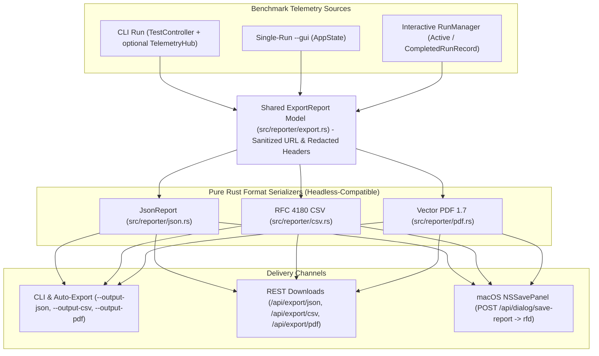

# Implementation Plan: PDF and CSV Export Formats for Completed Load-Test Runs

- **Tracking Issue:** [seanr89/rusty-loader#10](https://github.com/seanr89/rusty-loader/issues/10)
- **Branch:** `feat/pdf-csv-exports` (branched from `main` after PR #11 / `39d3bc3`)
- **Scope:** CLI (`--output-csv`, `--output-pdf`), single-run `--gui`, interactive macOS desktop UI (`--desktop`) with native `NSSavePanel`, and browser workbench (`--ui-serve`)

---

## 1. Context & Current Baseline

`rusty-loader` (`0.2.0`) currently exports benchmark results exclusively as JSON across three entrypoints:

1. **CLI JSON Exporter (`--output-json`, `src/reporter/json.rs`, `src/reporter/mod.rs`):**
   - `JsonReport::new(&config, &stats)` serializes execution metadata alongside flattened `BenchmarkStats`, called by `report_results(&config, &stats)`.
   - `tests/reporter_test.rs` (specifically `test_json_output_file_creation_and_deserialization`) validates exact roundtrip keys and expects CLI `JsonReport::new` to preserve raw configured headers cleanly.
2. **Single-Run `--gui` Export (`src/gui/api.rs`):**
   - `GET /api/export/json` returns a `JsonReport` with `sanitize_url(&state.config.url)` and `redact_headers(&state.config.headers)`.
3. **Interactive macOS Desktop & `--ui-serve` Export (`src/gui/interactive.rs`, `src/gui/manager.rs`, `src/desktop/mod.rs`, `src/gui/assets/`):**
   - `CompletedRunRecord` (`src/gui/manager.rs`) already retains both cumulative `Option<BenchmarkStats>` and `Vec<TelemetrySnapshot>` (`250ms` windowed ticks) in session memory.
   - `GET /api/export/json?run_id=...` downloads a redacted `JsonReport`, and `POST /api/dialog/save-json` writes it via `NativeDialogRequest::SaveJsonFile` (`rfd::FileDialog` on macOS thread 0).
   - In `src/main.rs`, `TelemetryHub` is only instantiated when `--gui` is enabled, though `TelemetryHub` (`src/metrics/snapshot.rs`) is already feature-independent and compiled unconditionally.

This plan adds **CSV** (rectangular time-series + cumulative summary) and **PDF** (offline vector summary + time-series charts) export formats consistently across CLI, HTTP/SSE servers, and the macOS desktop application without adding native C dependencies or impacting the `< 50 MB` CLI RSS guardrail.

---

## 2. Architecture & Crate Decisions

### Selected Crates
| Need | Crate | Version | Transitive Dependencies | Rationale |
| :--- | :--- | :--- | :--- | :--- |
| **CSV Serialization** | `csv` | `1.4` | `csv-core`, `itoa`, `ryu`, `serde_core` | Pure Rust RFC 4180 writer/reader with automatic quoting and minimal binary overhead. |
| **PDF Generation** | `pdf-writer` | `0.15` | `bitflags`, `itoa`, `memchr`, `ryu` (all already in `Cargo.lock`) | Typst team's pure Rust PDF 1.7 writer; zero C libraries, zero bundled TTF/OTF blobs, zero OS font lookup failures. Uses PDF Standard 14 fonts (`Helvetica`, `Helvetica-Bold`, `Courier`) and native vector drawing primitives (`rect`, `move_to`, `line_to`, `stroke`, `fill_nonzero`, `set_line_dash`). |

### Alternatives Evaluated
- **`printpdf 0.12`:** Heavy transitive dependency graph for simple tabular/vector reports.
- **`krilla 0.8`:** Requires embedding TTF/OTF font files or querying system fonts (risks missing fonts in headless Linux/CI or bloating binary size).
- **macOS `WKWebView` PDF Printing:** Only works inside AppKit desktop mode (`--desktop`), leaving CLI `--output-pdf`, `--ui-serve`, and Linux builds unsupported.

### CLI Time-Series Capture Without `--gui`
`TelemetryHub` (`src/metrics/snapshot.rs`) is already compiled unconditionally outside `#[cfg(feature = "gui")]`. In `run_cli_benchmark()` (`src/main.rs`):
- Whenever `--output-csv` or `--output-pdf` is passed (even without `--gui`), instantiate `TelemetryHub::new(config.duration, config.ramp_up)` and attach it to `TestController::with_telemetry_hub(...)`.
- After `controller.run().await?`, read `hub.history()` snapshots and pass them to `report_results_with_snapshots(&config, &stats, &snapshots)` so CLI CSV and PDF exports include full `250ms` time-series telemetry and Page 2 PDF charts.
- When none of `--gui`, `--output-csv`, or `--output-pdf` are set, `TelemetryHub` is not attached—preserving zero overhead on the standard CLI hot path.

### Export Architecture Flow



---

## 3. Data Contracts & Formatting Specifications

### 1. Shared Export Model (`src/reporter/export.rs`) & Headless Redaction (`src/config.rs`)
- Move `redact_headers(headers: &HeaderMap) -> HashMap<String, String>` from `src/gui/api.rs` into `src/config.rs` alongside `is_sensitive_header` and `sanitize_url`, and re-export `redact_headers` in `src/gui/api.rs` so `--no-default-features` headless builds share the exact same redaction logic without `gui`.
- Define `ExportFormat` (`#[derive(Debug, Clone, Copy, PartialEq, Eq, Serialize, Deserialize)] #[serde(rename_all = "snake_case")]`):
  - `Json`, `Csv`, `Pdf`
  - Methods: `extension(&self) -> &'static str`, `content_type(&self) -> &'static str`, `default_filename(&self) -> &'static str` (`"rusty-loader-report.{json,csv,pdf}"`), `dialog_filter(&self) -> (&'static str, &'static [&'static str])`.
- Define `ExportReport`:
  - `app_version: String` (`CARGO_PKG_VERSION` / `APP_VERSION`)
  - `timestamp: String` (ISO-8601 UTC)
  - `preset_name: Option<String>`
  - `url: String` (always passed through `sanitize_url`)
  - `method: String`
  - `concurrency: usize`
  - `configured_duration_secs: f64`
  - `ramp_up_secs: f64`
  - `timeout_ms: u64`
  - `headers: HashMap<String, String>` (always passed through `redact_headers`)
  - `stats: BenchmarkStats`
  - `snapshots: Vec<TelemetrySnapshot>`
- Constructors:
  - `ExportReport::from_config_redacted(config: &BenchmarkConfig, stats: &BenchmarkStats, snapshots: Vec<TelemetrySnapshot>, preset_name: Option<String>) -> Self`
  - `ExportReport::from_completed_record(record: &CompletedRunRecord) -> Option<Self>`
- Shared file writer `write_export_bytes(path: &Path, bytes: &[u8]) -> Result<()>` (creates missing parent directories automatically via `fs::create_dir_all`).

### 2. CSV Schema & Formula-Injection Protection (`src/reporter/csv.rs`)
- **Strictly Rectangular 26-Column Schema** (immediately parseable by Excel, Google Sheets, Pandas `pd.read_csv`, and DuckDB):
  ```text
  record_type,timestamp_ms,elapsed_secs,phase,url,method,concurrency,active_workers,total_requests,window_rps,avg_rps,bytes_per_sec,total_bytes,successful_requests,client_errors,server_errors,other_statuses,transport_errors,min_ms,mean_ms,p50_ms,p90_ms,p95_ms,p99_ms,p99_9_ms,max_ms
  ```
- **Row Semantics:**
  - `record_type = "tick"`: One row per `TelemetrySnapshot` in `snapshots`, ordered chronologically (`p99_9_ms` left empty `""` on window rows since `WindowLatencyMs` captures `min..p99, max`).
  - `record_type = "summary"`: Always emitted as the final row containing cumulative `BenchmarkStats` (including `p99_9_ms`, `avg_rps = stats.requests_per_sec`, `elapsed_secs = stats.total_duration_secs`, `active_workers = 0`). Even when `snapshots` is empty (e.g., short runs or synthetic unit tests), header + summary row are always produced cleanly.
- **CSV Formula Injection Neutralization (`escape_csv_formula`):**
  - Any untrusted string field (`url`, `phase`, `method`, or future metadata cells) starting with `=`, `+`, `-`, `@`, `\t`, or `\r` is prefixed with `'` (`format!("'{value}")`) before passing to `csv::Writer`.
  - Numeric columns (`window_rps`, `p50_ms`, `total_requests`, etc.) are formatted directly as numbers and never altered.

### 3. PDF Visual Layout (`src/reporter/pdf.rs`)
- **Geometry & Typography:** US Letter (`612.0 x 792.0 pt`), `36.0 pt` margins (`540.0 pt` printable width), clean light print-friendly color palette (`#0f172a` ink, `#475569` secondary text, `#0369a1` brand accent, `#e2e8f0` hairlines, `#f8fafc` muted cards), built-in Standard 14 Type1 fonts (`Helvetica`, `Helvetica-Bold`, `Courier`).
- **WinAnsi Text Sanitization (`pdf_sanitize_winansi`):** Normalize or map non-WinAnsi Unicode characters (e.g., `—` -> `-`, `µ` -> `u`, non-Latin fallback `?`) so PDF strings render cleanly in Standard 14 fonts across Preview, Adobe Acrobat, and Chrome PDF viewer without missing glyphs.
- **Page 1 — Executive Summary & Breakdowns:**
  1. **Header Banner:** `rusty-loader vX.Y.Z — Load Test Report`, UTC timestamp, optional preset badge, and completion duration.
  2. **Configuration Metadata Block:** Redacted target URL (wrapped cleanly if long), HTTP method, target VUs, configured duration, ramp-up, request timeout, and redacted request headers table (capped/wrapped cleanly to prevent overflow).
  3. **KPI Strip (6 Cards):** Total Requests, Average Throughput (`req/s`), Transfer Rate & Total Bytes, Success Rate (`%`), Error Rate (`%` + count), Median / p99 Latency (`ms`).
  4. **Cumulative HDR Latency Percentiles Table:** `Min`, `Mean`, `p50`, `p90`, `p95`, `p99`, `p99.9`, `Max`, `Std Dev`.
  5. **HTTP Status Code & Transport Error Breakdown Tables:** Sorted status distribution (code, reason phrase, count, percentage share) and transport error categories (or `"None (0 errors)"` when clean).
- **Page 2 — Time-Series Vector Charts (emitted when `snapshots.len() >= 2`):**
  - Shared `draw_vector_chart(...)` helper plotting vector gridlines, axis tick labels, polylines, dashed lines, legends, and optional dual Y-axis matching the desktop UI series colors:
    1. **Throughput & Active VUs:** `Window RPS` (`#0ea5e9`), dashed `Avg RPS` (`#6366f1`), right-axis `Active VUs` (`#f59e0b`).
    2. **Windowed HDR Latency Percentiles (ms):** `p50` (`#10b981`), `p90` (`#38bdf8`), `p95` (`#f59e0b`), `p99` (`#f43f5e`), dashed `max` (`#a855f7`).
    3. **Per-Tick Responses & Errors by Class:** `2xx` (`#10b981`), `4xx` (`#f59e0b`), `5xx` (`#ef4444`), `Transport` (`#ec4899`).

---

## 4. Phased Implementation Plan

### Phase 1 — Shared Export Model & Headless Redaction (`Cargo.toml`, `src/config.rs`, `src/gui/api.rs`, `src/reporter/export.rs`, `src/reporter/mod.rs`)
1. **`Cargo.toml`:** Add `csv = "1.4"` and `pdf-writer = "0.15"` under `[dependencies]` (unconditional, available in default, `gui`-only, and `--no-default-features` CLI builds).
2. **`src/config.rs` & `src/gui/api.rs`:** Move `redact_headers` into `src/config.rs` (right beside `is_sensitive_header` and `sanitize_url`) and re-export `pub use crate::config::redact_headers;` in `src/gui/api.rs`.
3. **New `src/reporter/export.rs` & `src/reporter/mod.rs`:**
   - Implement `ExportFormat`, `ExportReport`, `write_export_bytes`, and `report_results_with_snapshots(&config, &stats, &snapshots)`.
   - Keep `JsonReport::new` (`src/reporter/json.rs`) and `report_results(&config, &stats)` backwards-compatible so existing `tests/reporter_test.rs` assertions remain 100% green.

### Phase 2 — CSV Exporter & CLI Flags (`src/reporter/csv.rs`, `src/cli.rs`, `src/config.rs`, `src/presets.rs`, `src/main.rs`, `src/gui/manager.rs`)
1. **New `src/reporter/csv.rs`:** Implement `escape_csv_formula`, `serialize_csv_report(&ExportReport) -> Result<String>`, and `export_csv_report(path: &Path, report: &ExportReport) -> Result<()>`.
2. **`src/cli.rs`:** Add:
   - `#[arg(long = "output-csv")] pub output_csv: Option<PathBuf>`
   - `#[arg(long = "output-pdf")] pub output_pdf: Option<PathBuf>`
3. **`src/config.rs` & Struct Initializers:**
   - Add `pub output_csv: Option<PathBuf>` and `pub output_pdf: Option<PathBuf>` to `BenchmarkConfig` and `BenchmarkConfigInput` (`#[serde(default)]`).
   - Update all struct-literal `BenchmarkConfig` initializers (`src/client.rs`, `src/reporter/mod.rs`, `src/engine/mod.rs`, `tests/gui_test.rs`, `tests/client_worker_test.rs`, `tests/reporter_test.rs`, `tests/integration_test.rs`, `tests/orchestrator_test.rs`) and `BenchmarkConfigInput` initializers (`src/config.rs`, `tests/presets_test.rs`, `tests/run_manager_test.rs`).
4. **`src/presets.rs`, `src/main.rs`, `src/gui/manager.rs`:**
   - Extend `format_cli_command()` (`src/presets.rs`) to emit `--output-csv` and `--output-pdf` when configured.
   - Update `initial_input_from_cli()` and `run_cli_benchmark()` (`src/main.rs`) to attach a `TelemetryHub` whenever `--gui`, `--output-csv`, or `--output-pdf` is set, and pass collected snapshots to `report_results_with_snapshots()`.
   - Update `RunManager::start_run_with_tick_interval()` (`src/gui/manager.rs`) to also write `output_csv` and `output_pdf` when configured on an interactive run.

### Phase 3 — Offline Vector PDF Report Generator (`src/reporter/pdf.rs`, `src/reporter/mod.rs`)
1. **New `src/reporter/pdf.rs`:**
   - Implement `generate_pdf_report(&ExportReport) -> Result<Vec<u8>>` and `export_pdf_report(path: &Path, report: &ExportReport) -> Result<()>`.
   - Implement `PdfCanvas` helper wrapping `pdf_writer::Content` with top-down coordinate conversion (`y_pdf = 792.0 - y_top`), text truncation/wrapping, WinAnsi sanitization, rounded/bordered KPI cards, table row renderers (with header-row overflow clamping + `"(+N more)"` indicator if a target sends dozens of headers/status codes), and `draw_vector_chart` for Page 2.
2. **`src/reporter/mod.rs`:** Export `pub mod pdf;`, `pub use pdf::{export_pdf_report, generate_pdf_report};`, and invoke `export_csv_report` / `export_pdf_report` in `report_results_with_snapshots()`.

### Phase 4 — HTTP Endpoints, Native macOS Save Dialog & UI Export Controls (`src/gui/`, `src/desktop/mod.rs`, `src/gui/assets/`)
1. **`src/gui/manager.rs`:** Add `pub fn export_report_data(&self, run_id: Option<&str>) -> Option<ExportReport>` building a redacted `ExportReport` (with snapshots + stats + `preset_name`) for the requested `run_id`, active run (partial snapshots + partial stats), or latest completed run.
2. **`src/gui/api.rs` & `src/gui/interactive.rs`:**
   - Add `GET /api/export/csv` and `GET /api/export/pdf` to both `build_router()` (CLI `--gui`) and `build_interactive_router()` (session-auth middleware protected, accepting `?run_id=<id>`), returning `Content-Type` (`text/csv; charset=utf-8` / `application/pdf`), `Content-Disposition: attachment; filename="rusty-loader-report.{csv,pdf}"`, and `Cache-Control: no-store`.
   - Generalize `NativeDialogRequest` (`src/gui/interactive.rs`) and `src/desktop/mod.rs` to handle `SaveReportFile { format: ExportFormat, default_name: String, resp }` using format-specific `rfd::FileDialog` filters (`"JSON Report" / ["json"]`, `"CSV Report" / ["csv"]`, `"PDF Report" / ["pdf"]`).
   - Add `POST /api/dialog/save-report` accepting `{ format: "json" | "csv" | "pdf", run_id?: string }`, and keep `POST /api/dialog/save-json` as a delegating backwards-compatible alias.
3. **`src/gui/assets/{index.html,styles.css,app.js}`:**
   - Consult `modern-web-guidance` (e.g., `menu` / `popover` / `button` guidance) before editing UI markup/JS.
   - Replace the single topbar `Export JSON` control with an accessible **Export** menu/dropdown (`JSON (.json)`, `CSV (.csv)`, `PDF (.pdf)`) that triggers `POST /api/dialog/save-report` when `system.native_dialogs` is true or downloads `/api/export/{json,csv,pdf}` in browser mode.
   - Add per-format export actions (`JSON`, `CSV`, `PDF`) or selector on Session Run History rows so archived runs can also be exported directly in any format.
   - Optionally expose optional `Auto-Export CSV Path` and `Auto-Export PDF Path` fields inside a compact collapsible "Auto-Export Paths" disclosure in the Configuration sidebar (ensuring zero literal `"http://"` / `"https://"` strings in `index.html`, `styles.css`, and `app.js`).

### Phase 5 — Automated Testing, RSS Guardrail & Documentation (`tests/`, `README.md`)
1. **New `tests/export_test.rs`:**
   - Parse CSV output using `csv::Reader` to verify exact 26-column rectangular shape across both tick+summary runs and zero-tick summary-only runs.
   - Test CSV formula-injection neutralization (`=CMD|...`, `+...`, `-...`, `@SUM(...)` in URL/fields prefixed with `'`, while numeric metrics remain unquoted/unmodified).
   - Verify PDF bytes start with `%PDF-1.7`, end with `%%EOF`, include `/Count 1` when `< 2` snapshots exist and `/Count 2` when `>= 2` snapshots exist, and pass non-ASCII WinAnsi sanitization safely.
   - Verify `Authorization`, `Cookie`, `X-Api-Key`, and URL credentials are redacted (`[REDACTED]`) in both CSV and PDF outputs.
   - End-to-end CLI test running `rusty-loader --url ... --output-json ... --output-csv ... --output-pdf ...` against `wiremock` and asserting all three files are generated and valid.
2. **Extend Existing Tests:**
   - `tests/cli_parsing_test.rs`: test `--output-csv` and `--output-pdf` flags.
   - `tests/gui_test.rs`: test `GET /api/export/csv` and `GET /api/export/pdf` on single-run `--gui` server.
   - `tests/run_manager_test.rs`: verify `401 Unauthorized` without session token on `/api/export/csv`, `/api/export/pdf`, and `/api/dialog/save-report`, and `200 OK` + valid payloads with session token (including `?run_id=...`).
3. **Verification & Docs:**
   - Run `cargo test`, `cargo test --no-default-features`, `cargo test --no-default-features --features gui`, `bash scripts/verify_50_vu_load.sh` (`< 50 MB` RSS), and `make macos-bundle`.
   - Update `README.md` CLI Options Reference and Export section covering JSON, CSV, and PDF exports.

---

## 5. File & Module Change Matrix

| File | Phase | Status | Responsibility |
| :--- | :--- | :--- | :--- |
| `Cargo.toml` | 1 | Modified | Add `csv = "1.4"` and `pdf-writer = "0.15"` |
| `src/config.rs` | 1–2 | Modified | Move `redact_headers`; add `output_csv` & `output_pdf` to `BenchmarkConfig` & `BenchmarkConfigInput` |
| `src/reporter/export.rs` | 1 | New | `ExportFormat`, `ExportReport`, redacted constructors, file writer helper |
| `src/reporter/csv.rs` | 2 | New | Rectangular RFC 4180 CSV serializer + formula-injection neutralization |
| `src/reporter/pdf.rs` | 3 | New | Pure Rust offline vector PDF 1.7 generator (KPIs, HDR/status tables, vector charts) |
| `src/reporter/mod.rs` | 1–3 | Modified | Export `export`, `csv`, `pdf`; add `report_results_with_snapshots()` |
| `src/cli.rs`, `src/presets.rs`, `src/main.rs` | 2 | Modified | Add `--output-csv` / `--output-pdf`, CLI formatter, conditional `TelemetryHub` capture |
| `src/gui/manager.rs`, `src/gui/api.rs`, `src/gui/interactive.rs` | 2, 4 | Modified | Auto-export CSV/PDF on completion, `/api/export/{csv,pdf}`, `/api/dialog/save-report` |
| `src/desktop/mod.rs` | 4 | Modified | Format-aware `rfd::FileDialog` filters for JSON, CSV, and PDF |
| `src/gui/assets/{index.html,styles.css,app.js}` | 4 | Modified | Export format menu in topbar & history rows, optional auto-export path inputs |
| `src/client.rs`, `src/engine/mod.rs`, existing `tests/*.rs` | 2, 5 | Modified | Add `output_csv: None, output_pdf: None` to struct literals + new CLI/HTTP tests |
| `tests/export_test.rs` | 5 | New | Unit & integration tests for CSV schema, formula escaping, PDF structure, redaction, and CLI export |
| `README.md` | 5 | Modified | Document `--output-csv`, `--output-pdf`, and UI export options |

---

## 6. Verification Commands Matrix

| Phase | Verification Command |
| :--- | :--- |
| **Phase 1–2** | `cargo test --lib` && `cargo test --test cli_parsing_test` && `cargo test --test reporter_test` |
| **Phase 3–4** | `cargo test --test export_test` && `cargo test --test gui_test` && `cargo test --test run_manager_test` |
| **Phase 5** | `cargo test` && `cargo test --no-default-features` && `cargo test --no-default-features --features gui` && `bash scripts/verify_50_vu_load.sh` && `make macos-bundle` |

---

## 7. Key Pitfalls & Engineering Risks

1. **Preserving Existing CLI `JsonReport` Contract:** `tests/reporter_test.rs` explicitly asserts unredacted `headers` inside `export_json_report` for local `--output-json` runs (`Some("Bearer token-123")`). Keep `JsonReport::new` untouched for CLI `--output-json`, while ensuring all CSV, PDF, and GUI/Desktop exports use `ExportReport::from_config_redacted` (`sanitize_url` + `redact_headers`).
2. **`BenchmarkConfig` Struct Literal Fan-Out:** Adding `output_csv` and `output_pdf` touches ~10 `BenchmarkConfig { ... }` test/module struct literals across `src/` and `tests/`; consider adding a `#[cfg(test)]` or `Default`-friendly constructor where helpful without breaking existing test readability.
3. **CSV Formula Injection (`CWE-1236`):** Untrusted URLs or header/preset names starting with `=`, `+`, `-`, `@`, `\t`, or `\r` must be escaped with a leading `'` in spreadsheet cells while keeping numeric metric columns unprefixed.
4. **PDF Standard 14 Encoding (`WinAnsi`):** Standard Type1 fonts (`Helvetica`, `Courier`) reject or misrender arbitrary multi-byte UTF-8 glyphs unless sanitized to WinAnsi/ASCII equivalents before encoding PDF string literals.
5. **PDF Page Overflow on Large Tables:** Targets returning many distinct HTTP status codes or configured with many request headers must paginate cleanly or cap/truncate secondary lists with an explicit `(+N more)` summary note rather than clipping off the page bottom.
6. **Offline Test Guardrail (`tests/gui_test.rs`):** HTML, CSS, and JS assets under `src/gui/assets/` must never contain literal `"http://"` or `"https://"` strings.
7. **Zero Hot-Path Regression:** Only attach `TelemetryHub` in CLI runs when `--gui`, `--output-csv`, or `--output-pdf` is set so standard CLI runs remain unaffected and peak RSS stays well below the `50 MB` limit.
